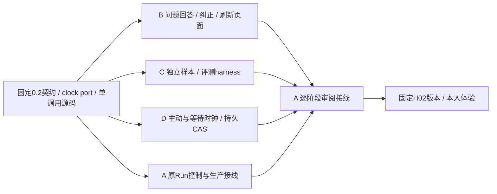

# MS-I2m：同Run问答、等待恢复与独立质量评测

2026-10-16。共同固定标签 `ms-i2m-start`；准确40位SHA见远端DISPATCH页首正式发布记录。范围对应P1-14/P1-15，并准备P1-16文本成果联调。H01-v5普通问答本人反馈认可；H02、事实质量、本机及协作整轮未接受。

## 1. 本轮目标与并行图

B/C/D的组件首轮互不依赖未提交代码。真实服务、固定模型导出、真实Idle库存是各自最终联调的明确依赖，A阶段到即提供，不能把受控组件通过当生产可用。

## 2. 固定输入、工作区与文件归属

先读[本轮接口](MS-I2m-AD-contract.md)、[P1-12详细对象](H02-P1-12-ports.md)、[H02计划](../../../plan/H02_CONVERSATION.md)及本session页。

| Session / 包 | 原目录与分支 | 本轮可写目录或文件 | 明确边界 |
| --- | --- | --- | --- |
| A / MS-I2m | E:/UAW / integration | 原A公共契约/shared/Run/API/装配/模型与Context适配、ops/conversation_probe.py；本轮协调/实施/主计划；新增A控制/阶段测试 | 不改B前端、C评测实现、D计时实现及它们测试；负责共享提案与真实来源 |
| B / MS-U4 | E:/UAW/.worktrees/context / dev/context | apps/web/；docs/coordination/requests/B/、handoffs/B.md；tests/.artifacts/B/ | 暂停Context优化；不改后端/公共契约/锁/生成契约源 |
| C / MS-E1 | E:/UAW/.worktrees/tool / dev/tool | **新**src/uaw/evaluation/；ops/evaluate_conversation.py；tests/unit/evaluation/、tests/fixtures/evaluation/；docs/implementation/evaluation/；requests/C/、handoffs/C.md、tests/.artifacts/C/ | 本轮临时改做独立质量门槛，原Tool交付保留；不修改原Tool/Runner/Run生产代码或通用ops |
| D / MS-K1 | E:/UAW/.worktrees/runner / dev/runner | **新**src/uaw/run/execution_clock.py；tests/unit/run_clock/、tests/integration/run_clock/；requests/D/、handoffs/D.md、tests/.artifacts/D/ | 本轮临时负责时钟组件，原Runner交付保留；不改clock_ports/shared/Run背景代码/预算/原Runner |

共同禁止改uv.lock、依赖配置、公共DTO/flags、其他session源码/测试或原失败回执。依赖新增或接口缺口写具名提案，A提交准确阶段后消费，不私造第二套协议。C/D临时新归属在本包结束后停止，不据旧Tool/Runner包续做本机链。新包不要求新建worktree。

## 3. A / MS-I2m：原Run控制与集成（连续M1–M4）

- **M1 读图和控制事务。** 实现RunConversationView/指定问题/原回执Reader、实际Idle库存adapter；精确0.2请求分支；同域追加不可变Input/patch/input_set/问题状态/Run事件，原用户归属、两层CAS、请求幂等。先发布接口与阶段SHA，不能把accepted写成applied。目标目录src/uaw/run/conversation_control.py、clock_sources.py、src/uaw/api/及A集成测试。
- **M2 安全续跑与时间接线。** 消费D时钟组件；原队列租约/fence安全唤醒，纠正在边界应用，旧模型结果不得发布为新答案，unknown对账不重发，未受影响材料保留。新调用按剩余主动预算构造新上下文，不改旧调用/审批/权限期限；总费用、固定用户模型及取消重新核对。独立实际服务版本到达即给B联调，保留H01-v5原快照/数据。
- **M3 文本成果与实际模型。** 粘贴办公/学术原材料进低信任Context，准确引用、文本/Markdown Artifact及逐项核验/用户接受；完成原Run问答/纠正实测。按C冻结的离线格式导出候选和历史基线，完整attempt/失败/费用/pending；不以强制模型自评替代事实门槛。阶段代码到即审B/C/D，业务错误交原worker。
- **M4 汇合与本人体验。** 逐包接受后跑受影响跨模块链与一次相应汇合全量，固定后端/dist/配置/样本；启动H02给本人体验聊天→澄清→纠正→成果、审批拒绝/取消/刷新。工程、质量、体验、用户接受分开；不得代本人操作。

## 4. B / MS-U4：自然对话与成果界面（连续M1–M4）

- **M1 精确客户端与读图。** 消费生成对象和五个固定端点，区分0.1旧提交与0.2新控制meta；从RunConversationView发现问题，不猜最后消息/文本，保持原身份/模型/历史。受控fixtures涵盖开放问题/审批等待/成果接受/旧协议503。提交阶段源码SHA和typed消费例后继续M2。
- **M2 原问题回答与纠正。** 自包含问题/原因/候选+自由输入；回答原run_id，新request_id只创建一次，校验当前Run/input/question版本；运行中纠正明确“已收到/已生效/已被后续修订替代”，草稿保留。终态新请求用原turn提交，不能发送原Run续跑。普通消息不出现成果接受；正式成果沿用原可读预览/准确版本接受。
- **M3 刷新、丢响应和冲突。** 同键查询恢复、跨页面CAS、事件重读、取消后回答/认证失效/服务缺源；草稿和pending request绑定账号+conversation+run，退出清理；不无限重试，不自动重发、停止、确认或接受。组件/受控Chromium实测原回执及失败保留。
- **M4 实际联调。** A公布准确新服务后使用原拥有者同Page/受保护会话，核对原Run接续、纠正、刷新和成果。受控工程可使用随机测试主体；本人会话只读观察，不替本人提交/授权/接受。真实来源未到准确写pending，不把旧H01-v5 404标生产验收。交冻结安装/类型/构建/相关单元/Playwright、dist hash/允许文件/最终源码与独立handoff。

## 5. C / MS-E1：独立质量评测（连续M1–M4）

- **M1 严格输入与报告。** 先读support.evaluation设计与H01-I02/I03原错误；实现固定CLI、版本manifest/样本/实际观测/独立review的严格类型与schema、可运行fixture和消费示例。阶段SHA提交后继续，不等待真实模型。不得生成“人工已审”或凭modelpassed评分。
- **M2 小样本与反例。** 建立12–20条有界可审阅候选样本，办公、学术、普通技术、必要材料缺失、合理歧义及纠正保留要求；关键事实有具体一手资料位置与hash/时间（联网必须实查）。TCC/ZooKeeper旧错误纳入，不能只做这一题专用规则。修订/保留集分开；无真正人工核对的样本标needs_human_review，不能让正式发布门槛passed。
- **M3 完整统计与拒绝错误通过。** 独立计答案错误、Reviewer漏判/N/A、不必要阻断、缺证据强行执行；给分母、失败、重试、主动/墙钟时间、pending与已确认成本。未运行、资料/manifest/输出hash不匹配、未审关键样本、零分母均明确incomplete/N/A，不能零错误即通过。语义评分依赖证据review，字符串只筛查。验证注入/伪造来源、重复attempt、不可比基线、无Reviewer、失败成本和新输出不覆盖旧报告。
- **M4 固定版本消费。** A提供准确实际输出/manifest后离线运行比较，写差异/仍需人工项与完整失败；未到保留harness组件接受但实测pending。交确定性命令、schema样例、报告、用例去重列表、实际来源和最终源码/独立handoff。不装新第三方库，不连接真实账号/模型/写工具；无需数据库，未跑SQL直接写N/A。

## 6. D / MS-K1：计时与持久恢复（连续M1–M4）

- **M1 纯计量与稳定入口。** 按固定ClockChange/ConversationClockPort/必需ClockIdlePort实现ExecutionClocks。正确结算主动/等待、毫秒UTC、原上限不变、真实超额保留/剩余0、倒退拒绝；受控时间仅可信构造注入，不能放请求体。阶段SHA及构造消费例到即交A，继续M2。
- **M2 事务与实际库存边界。** 实现当前owned原Run/conversation/binding/clock/问题和Item复核、CAS，以及clock+binding.ref同tx原子写；pause需必需effects.check库存复核、不得把提案空数组当idle。读不授权执行，取消/终态只可stop，stopped不可复活，不改Run/budget/旧deadline。组件库存夹具标受控，不宣称真实生产源。
- **M3 重启与并发SQL。** 自己55435真实SQL：同expected CAS单赢家、外层事务失败全回滚、两次等待/恢复、长等待超过原deadline仍只按原剩余读数、超额禁止续跑、原取消/归属/问题版本/clock pin改变、费用pending或unknown不能免费暂停；原Invocation/审批/root期限字段原字节不变。模拟重启与lease丢失不得重领时间；不借测试启动native窗口。
- **M4 A适配消费与交接。** 消费A真实Idle阶段源，按新旧clock写入边界验证读图/暂停与恢复；缺生产库存/完整队列/Model接线准确记pending，不替A实现。交注入/关闭兼容例、实际SQL/静态/类型回执、失败历史/不同节点数与最终源码+独立handoff。组件通过不标P1-14/H02整轮接受。

## 7. 同步、并行节奏与验证

worker自行检查干净→fetch origin --tags→只读 `git show origin/integration:docs/coordination/DISPATCH.md` 核对本轮准确SHA→`git rev-parse 'ms-i2m-start^{commit}'`一致→`git merge --ff-only ms-i2m-start`→HEAD同SHA→按原锁同步独立环境。**不合并浮动integration**；基线内未包含之后发布的元数据属正常，不据历史旧派发再次停工。同步非快进就保留现场提案，不reset/rebase/stash/rewrite。

A不操作worker分支/工作区。B/C/D各M1可消费接口、M2核心行为后发阶段SHA；余下本包继续。A逐阶段审阅、原worker修业务错误，不等三个最终交付才开始。四个里程碑是连续一个包，不是四次等待派发。

模块测试归worker：B冻结安装/类型/构建/受控Playwright，C离线质量/输入反例，D自己55435实际SQL；A55432做Run/API与受影响跨模块，不重复全仓每个阶段。B55433/C55434保留；本轮C无需SQL。不要复制A凭据或占本人H01服务端口。

保持固定用户模型，子Agent/DAG/本机写入安装exec flags关闭。本轮开发会话并行不等于UAW运行时开启多Agent。缺生产source503，unknown先对账不重发。所有失败、历史标签、旧handoff、pending费用、旧last_full保留；汇合前不提前做新全量通过声明。

## 8. 退出、交付及本人测试

每个worker交允许文件清单、基线/阶段/最终源码及独立handoff SHA、精确命令/环境/去重节点、失败修复历史、未装配来源、构造和关闭示例。包结束干净并停止；同步下一基线需新包。

A审查源码、契约及实际回执后分组件接受；H02必须实际原Run问答、纠正、长等待/权限、文本成果及独立质量门槛再做本人体验。H01-v5现有服务保留，不热改、不改写原失败和用户历史。文档、受控工程、实际模型、本人满意、成果接受各自记录；本机原首次签名文件链继续独立未完成。
