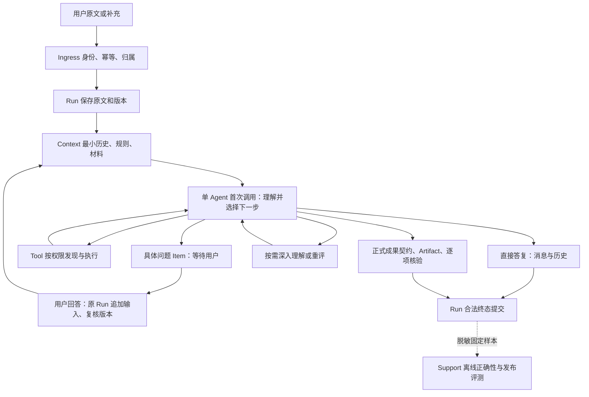

# 对话与成果执行设计

架构 v0.11，2026-10-14。**用户已确认方向，以下新增行为待实现。** 决策见 [ADR-001](../decisions/ADR-001-conversation-and-delivery.md)，接口迁移见 [CONVERSATION_REVISION](../api/CONVERSATION_REVISION.md)。

## 1. 大模块联系

图是职责关系，允许回路。任务 DAG 与父子 Agent 仅在需要时物化。独立评测不位于每条回复的固定运行链。

## 2. 首次调用：谁决定，怎样决定

Agent 读取不可变用户原文、相关历史、当前固定模型政策、可用工具摘要和剩余资源。使用短核心规则说明：回答用户问题；小歧义可明确假设或列出少量解释；缺少必需材料或高影响动作的必要条件才提问；不声称未执行的搜索、读取或测试。

**同一次调用**可以形成答复、工具提案或具体补充问题，并输出必要的理解/执行摘要。Intent 消费其中的理解信息，不能为保存 TaskFrame 再强制调用一次模型。简单答复也不因理解摘要缺失而自动升级为昂贵流程；最小来源记录可以直接指向原文。复杂任务需要时才调用独立理解或规划。

代码验证结构、主体、模型身份、权限、预算、引用和合法状态；不会用词典或长度判定复杂度。提示词与动作 schema 先更新公共契约再接线，未知动作拒绝，不能降级成执行任意文本。

| 下一步 | 必需处理 | 可选处理 |
| --- | --- | --- |
| 普通回复 | Message/Item、原文来源、Run 版本、用量与合法终态 | 需要时查证；理解提示可来自同次调用 |
| 工具调用 | Tool 预检、真实执行、效果/费用账本、观察结果 | 并发只读、按需证据检索 |
| 询问用户 | 有具体问题的稳定 Item、等待原因、所需输入、暂停检查点 | 有限候选或可先给出的部分解释 |
| 正式交付 | DeliveryContract、实际 Artifact/来源、逐项核验、交付/接受条件 | Skills、Reviewer、子 Agent、Join |

目标是无工具的普通交流一次成功调用；工具回合、补充后的答复、真实失败重试另计，不伪造“一次调用”指标。用户明确要求报告、文件、代码变更等成果时按契约交付。普通讨论中的只读查询也可返回聊天消息，不因为调用工具就强制变成报告。

## 3. 两类完成，不把低延迟变成无约束

**消息完成**：Run Controller 核对当前输入/Run 版本、取消、原模型结果、消息持久化、实际用量及依赖的未决效果后，事务提交消息终态与事件。没有 Artifact、逐项 VerificationReport 或成果接受的硬要求；模型不能直接写 completed。

**成果完成**：Completion Controller 对照原文和有效补充，检查每项要求、实际成果版本、真实证据、未决外部效果和合同所需用户接受。没有跑测试不能写 passed，未知效果先对账，不重发。模型语义报告说明支持和缺口，但不作为事实正确性的保证。

普通回复仍须说明假设和不确定性；允许有用的条件性解释。缺全文就不能声称读过或总结某篇论文；关键权限、收件人或操作目标不清时不得猜。运行中是否补查由任务需要决定。报告自身的语义评审按风险和合同选择，不强制独立 Reviewer Agent。

## 4. 同 Run 澄清与用户纠正

1. Agent 产出具体问题及原因。Run 原子提交问题 Item、waiting 状态和暂停检查点；重启不得重复模型提问。
2. UI 在原对话显示问题和“回答后继续”，提交 `run_id`、原问题 ID、预期版本和幂等键；不要求用户先停止再复制原问题。
3. Ingress 验证真实用户/会话归属。Run 按 CAS 追加新的不可变 InputRecord，记录 `clarification_answer` 或 `correction`、来源 Item 与任务修订，原文不覆盖。
4. 相同键同内容返回原受理回执；不同内容冲突。并发回答只有一个提交；旧问题已失效则返回最新状态。取消或终态胜出时拒绝续跑，终态后新要求创建新 Run。
5. 恢复前复核当前政策、模型、预算、目录/资料访问、授权、取消和未知效果。过期授权进入具体受阻/重新授权状态，不能自动复活。尚未发送的新调用使用本段剩余资源。
6. Intent/Context 更新有效原文与补充、必要理解和来源；Agent 仅将依赖修改内容的计划/结果标 stale，保留无关材料与成果版本。
7. 同一 Run 最多一个有效执行租约；事件断线后按稳定 Item/revision 恢复。若提交后响应丢失，查询回执，不再新建 Run。

运行中的纠正在工具安全边界生效；已经执行的外部动作不能凭对话撤销。若动作不能中断，UI 显示已收到但待安全边界处理。澄清与审批不是同一种授权：回答问题不等于批准工具。

## 5. 等待、执行、调用与授权四种时钟

| 时钟 | 所有者/规则 |
| --- | --- |
| Run 主动执行耗时 | Run 持久保存执行段及累计耗时，恢复按剩余额度；等待用户的暂停段不消耗主动执行时间 |
| 用户等待/保留期 | 单独记录 wait 起止与可配置空闲回收；空闲到期明确显示，不能偷偷当用户回答或批准 |
| 已派发调用 deadline | Model/Tool/Runner 原 deadline 不可修改；未结束调用仍按原期限执行、取消或对账 |
| 审批/设备/目录/租约有效期 | 按原来源独立到期和撤销，暂停不延长，续跑重新核验 |

只能在没有未结束执行调用、已持久化合法等待检查点时停止主动执行时钟。有在途不可取消操作先等待真实结果或记录 unknown，不能用“等待用户”掩盖执行费用。并行主动执行按 Run 活跃时间段的并集计时，模型/工具/子任务成本逐项累计；预留、失败、重试和 pending 费用始终受同一总额约束。

跨重启以持久段状态和可信服务时间恢复，防止重复累计、负耗时或重新领取完整时限；租约丢失后的在途时间不能直接记免费暂停。每次调用期限为剩余主动执行预算、调用上限和对应有效来源限制的最小值。续跑不延长已发出的 15 秒/90 秒等原本机调用。

## 6. 正确性评测独立于运行中的 Reviewer

Support Evaluation 管版本样本和报告，领域 Runtime 提供实际输入、输出与受控证据。先建立人工查证的小集合：普通概念解释/歧义比较、发散问题、缺材料必须提问、办公原文整理、学术主张与证据、澄清与纠正。

每个样本包含原始输入/材料、允许假设、必须事实、常见错误反例、可接受行为及人工依据；不要求答案逐字一致。训练修订集与保留集区分，防止只记住测试表达。H01 技术比较的人工发现转为反例，依据核对后才成为参考答案。

分别报告：答案关键事实错误率；Reviewer 对错误回答给 passed 的漏判率（分母是确有错误且被评审的答案）；不必要阻断率；必需材料/授权缺失时错误执行率；调用数、实际执行时间、用户总等待、全部费用/未知账单。未使用 Reviewer 的普通回复记“不适用”，不能当零漏判。

相关提示词、路由、上下文或核验策略变化须跑固定样本；关键概念错误、伪造执行证据、原任务续跑丢失要求为阻断项。非关键质量/耗时阈值在跑样本前记录，按候选与基线比较；没有真实账单不宣布实际费用达标。模型评分可辅助定位，人工参考为最终事实基准。

## 7. 目录与实现边界

| 大模块 | 细分职责 | 目标位置/现有入口 |
| --- | --- | --- |
| Agent | 首次决策、消息/交付分支、补充后局部失效 | src/uaw/agent/；src/uaw/run/background.py 接线 |
| Run | 原文追加、问题所属权、控制 CAS、计时/租约、完成提交 | src/uaw/run/；src/uaw/api/ |
| Intent/Context | 同次理解消费、补充来源、上下文复查 | src/uaw/intent/；src/uaw/context/ |
| Completion/Artifact | 文本成果契约、引用、报告、接受 | src/uaw/agent/completion/；src/uaw/workspace/ |
| Support Evaluation | 人工样本、真实模型运行、独立质量报告 | tests/fixtures/evaluation/；ops/；docs/implementation/evaluation/（待建设） |
| UI | 问题答复、续跑/纠正反馈、刷新恢复、成果审阅 | apps/web/src/（B 负责业务实现） |

目标目录不是已存在 API 或完成声明。实际开发须先固定公共协议与来源，由原 owner 实现；本机文件/协作目标保持独立门槛。
