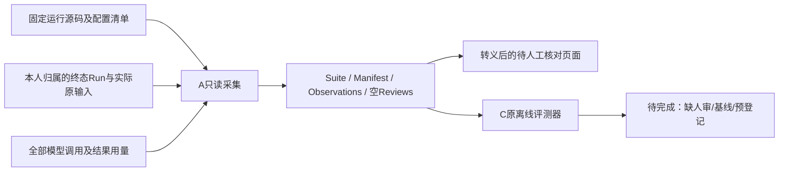

# A10：真实任务记录接入独立质量评测

2026-10-17。A 负责读取实际 Run、原输入、模型结果和用量，转换为 C/MS-E1 已冻结的四文件格式；C 的评测器、类型和候选题集没有修改。此阶段完成数据接线，P1-15 事实质量验收继续进行。

## 1. 目录与责任

| 位置 | 处理策略 |
| --- | --- |
| `src/uaw/run/evaluation_capture.py` | PostgreSQL 只读一致性快照、原记录复核、四文件转换、待审页面 |
| `ops/capture_conversation_evaluation.py` | 操作者指定配置、固定运行快照、任务、样本、政策与新输出目录；不提供用户 HTTP 接口 |
| `tests/integration/agent/test_evaluation_capture.py` | 实际 SQL 验证成功/失败/正式成果及核验绑定、归属、篡改和未知用量边界 |
| `tests/unit/agent/test_evaluation_capture.py` | 源码漂移/目录逃逸、HTML 转义、已有输出不可覆盖 |
| `src/uaw/evaluation/`、`ops/evaluate_conversation.py` | C 原交付，按冻结格式消费；A 不代写其业务 |

## 2. 数据链与逐项约束

1. 操作者明确指定一个 Run；采用 `REPEATABLE READ, READ ONLY` 事务，复核用户归属、未删除的会话，最多读取512条记录。数据库强制只读，不经 Agent、队列或模型执行入口。
2. 从 `RunInputSet` 原 Ref 读取文字，核对输入版本/已有摘要及会话。追加输入按固定分隔符逐条拼接，样本必须逐字一致，不能以模型摘要替代。
3. 库存包含这个 Run 的全部 `model.invocations`，逐项关联 `model.attempts`、实际 `model.outputs` 和决策。失败保留实际代码/用量；不能只选择成功调用。输出与 invocation 内结果、模型配置、用量不一致则整包拒绝。
4. 调用按原 `operation_id` 分组计重试。原报告、纠正报告和两次核验是四个不同操作，不算三次重试。选择最终回答须显式提供 attempt，并证明它消费当前输入版本；旧回答不可充作纠正后的结果。
5. Reviewer 由原 `model.evaluation.inputs` 判定；绑定原 Run、唯一输出 Ref、版本及存在的摘要，再记录对应完整 Answer 的规范摘要。模型 `passed` 只进入 Reviewer 观测，不创建任何人工评分。
6. 每次实际请求与提供方返回配置都进入审计。固定模型/提供方版本必须一致；根生成和核验的不同容量分别保留。时间取实际 invocation 创建至 attempt 更新，主动时间使用已观察的提供方耗时；不是完整用户等待时间或执行时钟结算。缺主动时间时拒绝整个采集，不能填零或跳过调用。费用未知为 `null`，`pending` 不能当已确认账单。
7. 固定运行目录逐文件比对准确 Git 提交的261个文件，检查额外 Python 源码和目录逃逸；记录清单中的依赖/配置摘要及实际提示词/导出器字节摘要。本工具不重新测量历史时刻的依赖或配置。历史 Run 没有不可变的代码绑定证明，目前来源依据是原启动记录加当前固定目录字节，不冒充逐 Run 密码学证明。早于已记录源码切换时间的任务拒绝使用该运行清单。
8. 新建独占目录，JSON 沿用 C 的 fsync/排他发布，不覆盖旧结果；失败留下现场。HTML 对所有任务/模型文本转义并禁脚本和外部资源，无提交或接受按钮。

当前适配仅覆盖**单个终态、固定用户模型、conversation-v1、无 Tool 效果的 Run**。原记录不足、缺时间、跨模型或工具任务明确拒绝。选中答案可为空，以保存失败库存；不支持把全部历史任务、16条候选题集或未来基线自动补造成一次完整实验。

## 3. 实际采集与结果

读取保留的 H02-v4 自动诊断 Run `run-26abe943d8324d4db3fe3e2e043b9d0c`：原报告→核验→大学生就业纠正稿→核验，共4个实际调用；最终选择第二稿及其原核验。它是已有自动诊断，未替本人重新提问或接受。

- 最终采集包：`.data/evaluation/a10-capture-published/`；原始文字和模型结果留在本机忽略目录，先前所有采集文件保留。
- 累计输入11289、输出3741 tokens，4笔金额未知且pending；不新增模型调用，不写运行数据。
- C 原评测器实际运行：4个观测摘要验证、0重试、0人工评审，发布门槛 **incomplete**。缺人工核对、可比基线与事前登记；错误率/漏判率等分母为0时为N/A，不是零错误。
- 本次样本是事后整理的纠正案例，`needs_human_review`；不能冒充 C 原16条题集、保留集、预登记或新旧质量比较。该 Run 内没有模型失败；失败保留由真实 SQL 的失败场景验证，之前全部真实模型失败继续留在原 H02 回执。
- 首份私有导出曾以 Run 分组误计独立调用为重试，保留原文件；最终文件改用原 operation_id 后实测0重试，不覆盖初稿。

## 4. 验证、失败和下一步

最终4单元＋3个真实 SQL，共7个不同节点通过；4个变动 Python 文件静态/格式及242源码类型通过。[机器回执](evidence/ms-i2m-a10.json)。最初单元受限临时目录4个setup errors、后续原子hardlink被sandbox拒绝的1失败、SQL取消尚未经原队列收尾的1失败均保留；通过正常队列收尾，不改终态限制。

当前体验服务仍使用 A9a 源码和 B 固定前端，A10 离线工具不部署到请求链。发现服务进程已退出后用原 launcher/配置/数据库恢复，保留原日志和环境文件；不改变本人历史、原失败或接受状态。

下一步：人工核对固定候选题目与依据，登记真实实验政策，然后按准确候选/可比基线运行并收集独立审阅；不得补写历史登记时间。普通聊天继续不固定追加模型自评。H02本人反馈、事实质量、原本机链和Tool长墙钟分别保留未验项，last_full不变，B/C/D交付停止点不动。
