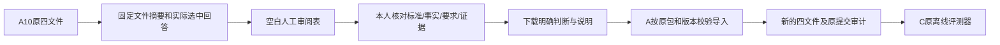

# A11：独立人工审阅的准备与导入

2026-10-17。A10已能只读采集真实任务，A11补齐“人怎样核对、核对结果怎样交给评测器”。本轮是独立离线工具，不改变聊天流程或B/C/D业务源码。

## 1. 模块与目录

| 位置 | 处理策略 |
| --- | --- |
| `src/uaw/run/evaluation_review.py` | 固定来源四文件、目标绑定、审阅包生成、严格提交解析、原格式导入 |
| `src/uaw/resources/reviews/human-review-v1.html` | 自包含表单；所有模型/材料文字用textContent显示，无外部资源或网络调用 |
| `ops/conversation_review.py` | `prepare`和`import`两个本机入口；不连接数据库/模型/队列 |
| `tests/unit/agent/test_evaluation_review.py` | 构造数据验证版本绑定、输入边界、测试评分隔离、原记录保留和CLI确认 |
| `src/uaw/evaluation/` | 消费C已冻结的Case/Manifest/Review及评测算法；本轮未修改 |

## 2. 链路与策略

1. C原Reader先校验严格结构；二次读取的实际字节须与原四文件摘要一致。再复核全部attempt pins、完整库存、Suite和原材料文字摘要，选择必须对应实际成功的Answer。缺答案/额外或缺失调用/篡改来源明确拒绝，不能用最后一条消息替代。
2. `packet.json`绑定原Suite/Manifest/Observations/Reviews的字节摘要、每个Case完整摘要和所选Answer完整摘要。HTML显示实际问题、追加要求、标准、允许假设、参考材料和对应回答；不显示模型passed来替代或诱导独立判断。
3. 所有评分/确认初始为空。使用者可判断标准需要修订、事实不确定、要求丢失、不必要阻断或虚构执行，并写具体说明。关键错误沿用C的必需布尔字段；其余允许未知的判断保留null。下载不代表已导入，不执行任务、不接受成果。
4. 人工文件必须逐个对应原目标，不接受错包、漏项、重复项、额外字段、空说明、缺实际阅读声明或不合理时间。确认要求真正布尔true；发现Pydantic `Literal[True]`会接受数字1，已改为严格bool加显式true校验。
5. 认为“可用”须同时确认事实/要求满足、无不必要阻断、无无证据操作、无关键错误；矛盾判断拒绝导入。标准需要修订时保持或恢复`needs_human_review`，不因填写评分就把题目核准。
6. `human_evidence_review`要求操作者提供真正独立人工填写的文件并明确`--ack-human-input`。身份标识和声明为操作者自报，**不是身份认证**；摘要只证明对应版本，不能证明人实际阅读。模型或自动测试不能生成正式人审。
7. `controlled_test`仅供构造测试，不能把待审样本升级为human_verified；C报告的人工计数仍为0。真实数据本轮未做任何受控或人工评分导入。
8. 导入只新建独占目录；原观察文件逐字复制，全部成功/失败/费用保持。正式人工核准只添加Case的人审元数据，更新Suite摘要和Review的对应绑定，不修改题目、rubric、来源或回答。保存原packet、提交及输入摘要，任何旧文件/目录不可覆盖。
9. 导入不修改Policy时间、阈值、baseline或模型源码信息，不决定发布门槛。当前事后诊断即使后续有人审，也不能变成事前登记实验或完整新旧比较。

范围：首次、单候选、无既有人审的四文件包，最多128个明确Case目标；现有A10真实包只有一个Case。已有Reviews、双版本基线或没有完整所选回答的包本版拒绝，继续保留原评测结果，不代造缺失答案。

## 3. 实际准备与验证

- 只读消费`.data/evaluation/a10-capture-published/`；其4个原模型调用及全部四文件字节未变。
- 最终待审页`.data/evaluation/a11-review-ready/index.html`，旁边`packet.json`固定目标。原首份准备包保留。**真人评分0、真实导入0、新模型调用0、运行数据写入0。**
- 23个不同单元/CLI节点最终通过；前15和21节点批次不重复累计。覆盖数字1/false确认、未知判断、错误版本、重复目标、矛盾可用结论、时间、源码文字注入、C受控计数以及原来源不变。
- 3个变动Python文件Ruff/格式、244源码类型通过；实际生成HTML解析、CSP脚本摘要、零预选项和Node语法检查通过。SQL不适用，未以旧SQL计本轮。
- **实际浏览器显示/下载仍待确认。** 内置浏览器安全策略拒绝打开`file://`页面，未通过其他浏览器表面/地址绕过；未点击任何人工声明/提交/接受。静态解析、语法及协议测试不算真实浏览器验收。
- 早期Ruff行长、一次Mypy字典类型推断及数字1可接受的开发诊断保留在机器说明；最终工程回执见[A11证据](evidence/ms-i2m-a11.json)。

H02-v4页面和后端ready实查200，仍为A9a/B原固定源码，本轮未重启或更改服务、数据库或本人历史。B/C/D原交付停止点保持；last_full与flags不变。

## 4. 下一步和未过项

本机用浏览器打开待审HTML后，可由本人核对并下载记录，再由A按明确来源导入；未有实际记录时始终保持待审。浏览器显示、真正人审、题目/依据校准、事前登记和固定候选/基线比较分别验收。H02本人重测、本机文件和Tool长墙钟仍独立跟踪；P1-15不标accepted。

[逐字段接口与命令](../coordination/requests/A/MS-I2m-A11-review-wiring.md) · [P1-15当前实施](P1-15.md)。
