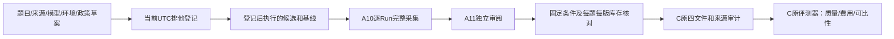

# A12：固定评测条件与新旧结果汇合

2026-10-17。A10提供单Run真实采集，A11提供人审准备/导入；A12把多题、候选与基线汇成C原评测器可读的一包数据。只完成离线组件和一个**未来测试的暂定登记**，没有宣称实际新旧质量比较完成。

## 1. 模块和目录

| 位置 | 职责与处理策略 |
| --- | --- |
| `src/uaw/run/evaluation_experiment.py` | 严格草案、当前时间登记、来源/版本复核、完整题目覆盖与汇总 |
| `ops/conversation_experiment.py` | `register`、`assemble`本机操作入口；不连接数据库、模型或运行队列 |
| `src/uaw/run/evaluation_review.py` | 已人工核准的Case在后续回答审阅时保留原核准元数据；避免破坏实验前的题目摘要 |
| `tests/unit/agent/test_evaluation_experiment.py` | 24个新构造节点；完整新旧比较、失败/unknown/重试、固定条件和原人审版本 |
| `tests/unit/agent/test_evaluation_review.py` | 23个既有受影响节点复验；测试评分不当真人判断 |
| `src/uaw/evaluation/`及`ops/evaluate_conversation.py` | 原C交付，类型/评分/比较规则不修改 |

## 2. 数据链与最小策略

1. 草案严格固定Suite、候选/基线源码和提示词、环境、完整ModelPin及政策阈值。两版ID必须不同；沿用C的比较规则，环境、模型/提供方/配置和provenance必须相同，比较轴为源码/提示词。配置不同不静默改摘要或输出差值，应另设计实验。
2. 登记CLI从实际当前UTC写入Policy，不接收日期参数；强制`baseline_required=true`。Suite/材料/已有题目人审时间不得来自未来，材料正文须与摘要一致。待人审题目可登记工程试验，但审计明确`needs_case_review`，不授权正式质量通过。
3. 登记文件与摘要是操作者本机记录，**没有第三方时间戳、签名或人行为认证**。文件排他发布并保留历史；改草案、政策、题目或条件须新登记，不补写旧日期。
4. 汇总必须明确提供每题每版恰好一个采集目录。少题、重复路径/目标、未登记版本、嵌套baseline或多题采集包均拒绝。本版最多128题/256个目录，总输入64MiB，读取后再次累计检查，输出遵守C的16MiB观测/8MiB审阅上限。
5. 每包Policy须等于登记值，Case完整对象及原Suite摘要须正确，源码/模型/环境/提示词逐项相等，dirty或不完整库存拒绝。原尝试不能早于登记，不能凭只改Manifest起点掩盖早发生的Observation；未来时间也拒绝。
6. 全部Model尝试、Review与显式Selection按Case/候选归属核对。成功、失败、unknown和重试均需保留；空观测不是已执行题目，不能拿成功结果替代失败题。失败可没有选中回答，最终C报告仍暴露缺审/失败/未知成本，不生成免费或通过结论。
7. 汇总时保留所有观测/审阅行，只连接文件并在缺末尾换行时补换行；不改文字、标签、费用或原调用ID。Manifest汇合原attempt pins/selection/起止区间，Suite改为原登记题集。每个原四文件字节摘要进入审计。
8. 输出只写新目录，保留原登记及来源审计，再调用C原`evaluate_files`生成报告。无新模型调用、无生成标签、无额外评分算法；CLI沿用0通过/1阻断/2输入拒绝/3未完成，组件测试通过不改变质量结果。
9. A11导入对已`human_verified`且用户仍确认标准的题目，不重写原核准人/时间/摘要；新的回答Review另行记录。如果标准存疑仍恢复待审，这会与旧登记冲突，应修订题目并重新登记，而非沿用旧条件。

本版每个实验采用一个完整ModelPin；若不同题/阶段产生不同完整配置摘要，必须显式拆分或重新设计实验，不把差异强行合成相同条件。汇总只证明所提供的明确采集库存，没有自动发现其他未声明Run；原始运行代码归属证明的局限继续见A10。

## 3. 实际登记与未发生的事情

核对既有H02-v3/A9与H02-v4/A9a的固定源码各261文件，实际settings字节摘要相同，原记录的依赖/配置/环境摘要一致。原报告诊断的两种已消费模型请求配置规范摘要相同，原ConfigurationRef相同；只读使用既有记录，不重测历史时刻依赖。

准备**一条未来报告纠正试验**：A9a候选`ebbcd9ea33557d23ddcda4569909893ce590da4d`与A9基线`01b3e6e4f3301c684ff4a29a53bf69128130497e`，按实际源码各自固定conversation提示词。暂定登记时间 **2026-10-17T14:21:36.657739+00:00**，规范摘要`273b2d35e31383913eb1e8086a9f44f855fad5687cf5610629f192375b8712c1`。

- 私有目录`.data/evaluation/a12-future-registration/`含登记、Suite、Policy和审计。
- 题目沿用事后草拟的报告纠正Case，**未人审**；登记只约束将来新执行，不把旧4调用或旧失败变成预登记结果。
- reviewer_required=false落实普通交流不强制自评，不禁止正式成果已有核验；暂定关键指标阈值为0。没有改变产品模型、预算或触发新调用。
- 本轮真实新执行0、实际比较汇总0、人审0。原C完整16候选仍0条human_verified，未冒充全部题集已登记/已验证。题目人审若改变对象，需要新登记后再执行。

## 4. 验证、失败及体验服务

最终47个不同节点通过＝24新实验＋23受影响审阅；4变动Python文件静态/格式、246源码类型通过。首轮22通过/1失败：构造Reviewer时间早于回答，被C正确判为不可比；改夹具时间后通过，原回执保留。[逐项机器证据](evidence/ms-i2m-a12.json)。SQL不适用，不计旧节点或更新last_full。

原测试服务端口曾停止响应，原因未定；保留原日志，使用原固定launcher恢复H02-v4。原页面和后端ready实查200，仍为A9a后端/B固定前端，同一数据库、身份、历史及环境文件不变。未代本人重发、确认或接受，A12不部署进聊天请求链。

## 5. 下一步

人工校准题目/依据、准备登记后隔离的新候选与基线执行，采集完整失败/用量，再做真正独立审阅和实际比较。A11本地页面显示/下载仍受先前file协议策略限制，未换浏览器表面或地址绕过；没有人审时保留pending。H02本人重测、本机文件链、Tool长墙钟各自验收；B/C/D保持交付停止点，未发新包。

[详细输入输出](../coordination/requests/A/MS-I2m-A12-experiment-wiring.md) · [P1-15实施](P1-15.md)。
