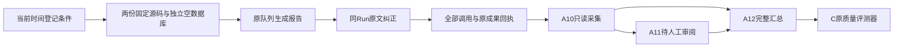

# A13：登记后的真实报告纠正对比

2026-10-18整理；实际模型执行于2026-10-17 UTC。本轮把A12登记、A10采集和C原评测器连成真实链路，并保留A9基线的失败。**工程对比已执行，事实质量未验收。**

## 1. 模块、目录和执行顺序

| 位置 | 处理策略 |
| --- | --- |
| `ops/registered_report_probe.py` | 在明确固定的隔离源码中运行原后台队列；原报告出现后向同一Run提交一次原文纠正，最多4次模型调用，不自动重试 |
| `src/uaw/run/evaluation_capture.py` | 保留失败Reviewer与原回答的目标绑定，结果为`unavailable`；可选隔离条件进入环境摘要，旧环境摘要保持 |
| `ops/capture_conversation_evaluation.py` | 原有只读采集入口，输出隔离条件与实际来源审计，不写运行记录 |
| `tests/unit/agent/test_registered_probe.py` | 检查原输入/一次明确纠正、拒绝猜测分段及环境摘要隔离 |
| `tests/integration/agent/test_evaluation_capture.py` | 真实PostgreSQL验证失败Reviewer、原所有权/只读采集和费用库存 |

1. 每版从准确Git提交导出261个文件，运行前后检查摘要。复用原锁定依赖，重新核对91个包的库存；固定同一用户模型、提供方、配置和原settings字节。
2. 每版新建空数据库及blob目录，只复制10条平台目录记录/19个版本；用户记录、网页会话和本机授权复制数均为0。没有访问本机文件或执行写入工具。
3. 采用原队列的手动tick以观察阶段，关闭其自动后台启动；blob命名空间也改变。两项有效配置变化在**新登记**前明确写入`evaluation_execution_scope`，并参与环境摘要，不冒用A12原部署环境。
4. 新登记时间为`2026-10-17T14:34:49.141764+00:00`，摘要`96ca9f9a9483b1a3b46e5321c57d332c6c433889b31d8b82e202250336f33ca8`。它是本机时间与摘要记录，没有外部时间戳认证。原A12暂定登记仍保存；本次不使用旧调用补填未来试验。
5. 只执行一条明确的“AI就业报告→特别关注大学生”纠正样例，原文和补充逐字保留。每版最多4次模型调用，等待每次原队列tick最多90秒、每份成果最多100秒；失败不重发。允许第4次调用之后的原`delivery`阶段收尾，不追加模型调用。
6. 使用实际`BackgroundAgent`、`ExecutionClocks`、`RunIdleEffects`、`ExecutionSegments`及`ConversationControls.correct`。运行结束只取消诊断自己尚未终态的Run，不代替用户接受成果。

## 2. 实际结果

| 观察 | A9a候选 | A9基线 |
| --- | --- | --- |
| 固定源码 | `ebbcd9ea33557d23ddcda4569909893ce590da4d` | `01b3e6e4f3301c684ff4a29a53bf69128130497e` |
| 模型调用/重试 | 4 / 0 | 4 / 0 |
| 原报告可读 | 是，约30.154秒 | 是，约29.585秒 |
| 最终补充状态 | applied | applied |
| 纠正后的正式成果 | 可读，约28.992秒；独立核验报告succeeded | 第二次生成完成，但随后Reviewer输出结构无效，未形成成功的新交付 |
| 模型失败 | 0 | 1，`provider_structured_output_invalid` |
| 输入/输出Token | 11135 / 3602 | 11015 / 3584 |
| 金额 | 4笔pending，金额未知 | 4笔pending，金额未知 |
| 诊断最终Run | 观察成功后由探针取消收尾 | failed |

基线的受理回执最初为accepted，**最终原库存已是applied**；不能仅凭早期回执说纠正未生效。候选的cancelled是探针结束诊断，不是模型调用失败或本人完成任务。两版都没有执行用户接受。

用于人工事实审阅的选中对象是各自完整的第二次生成回答；基线这段回答并非成功核验和交付的成果。两边原有核验通过都只作为模型观测，不能证明事实正确。

这是一个样例、每版一次的工程观察。不能把旧版Reviewer这次失败归因于某个提示词修复，也不能据此宣称普遍更快、更准确或发布质量提高。

## 3. 采集和评测的实际结论

两版所有8次调用、原尝试ID/耗时/来源/Token及失败均已进入原C格式。失败Reviewer保留准确目标和`unavailable`，C据此记为不可评价，不算“没有漏判”。8笔金额未知/pending，没有免费或每合格成果零成本结论。

实际A12汇总CLI退出码3，C报告为`release_gate=incomplete`、`comparison=incomparable`，不输出质量差值。来源、环境、模型、事前条件绑定通过；未过项为题目/依据未人工核对、回答无独立人审、无合格成果分母等。C原16候选题没有因此完成，P1-15仍开发中。

两版A11空白审阅包已准备，所有判断仍无预选。此前内置浏览器对file协议的拒绝继续保留，未另换地址或浏览器绕过；本轮没有真实显示/下载验收、人工打分或人工导入。

完整原回答和运行记录留在忽略的`.data/evaluation/a13-report-comparison-bb7dfa7a994e42ff8e224cef9ca71ea1/`；Git只保存脱敏结果、摘要和测试回执。[机器证据](evidence/ms-i2m-a13.json)。准备指针中的`new_model_calls=0`是执行前状态，不能替代最终8调用库存；其`supersedes_provisional_conditions`字段因内存对象修改误记为A13自身ID，原文件保留，本记录明确本次替代的是A12部署条件。

## 4. 验证、原记录和服务

5个单元＋4个真实SQL，共9个不同节点通过；5个Python静态/格式、247源码类型检查通过。不是全仓，不更新last_full。开发期间的静态问题已修正；原数据核对首次因快照含相同重复行而在数据库操作前停止，之后先验证重复摘要相同再按(namespace,id)去重，12条本人原记录逐项不变。

原H02测试服务曾停止，观察到其原数据库容器也已退出，停止原因未定。恢复使用原launcher、A9a后端/B固定前端、同一数据库/身份/历史；A13离线工具不部署到聊天路径。实际检查与恢复失败均写入机器回执，不把前端可访问当后端就绪。未代本人重发、确认或接受。

## 5. 后续门槛

下一步是独立核对题目/依据和两份实际回答；若改变题目标准，须按新题目重新登记后执行。H02本人重测、本机文件链和Tool跨墙钟独立验收。B/C/D保留原交付停止点，本轮没有新包或自动同步要求。

[准确接口与消费命令](../coordination/requests/A/MS-I2m-A13-real-comparison-wiring.md) · [P1-15进度](P1-15.md)。
