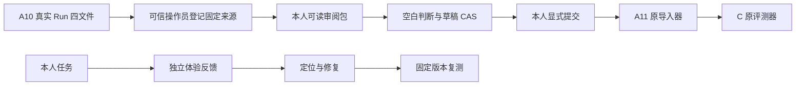

# A17：认证网页审阅、任务反馈与小样本复测

2026-10-18。起点 `d128e4e`；A 独立实施，B/C/D 停止点不变。本文先固定设计，实际结果另附回执。H02-v7 已交付审阅停钟修复；当前缺口是 A11 离线表单尚无认证网页保存/重开，用户反馈没有独立持久入口，16 题均待人审。

## 1. 模块及目录

| 模块 | 目录 | 策略 |
| --- | --- | --- |
| 对象 | `src/uaw/shared/quality.py`、`contracts/quality_catalog.py` | 严格 DTO；沿用 C 的 Case/Answer/Observation 和 A11 Packet；生成公共字典与 HTTP 文档 |
| 审阅服务 | `src/uaw/run/quality.py` | 所有人隔离、固定源四文件、审阅草稿 CAS、显式正式提交、原评测导出 |
| HTTP | `src/uaw/api/quality.py`、`routes.py` | 原认证、Origin/CSRF、请求大小、错误封装；无任意文件路径入口 |
| 页面 | `apps/web/src/features/quality/` | 原问题/材料/回答/引用/模型核验清楚关联，评分空白，保存和重开；任务反馈独立 |
| 来源登记/复测 | `ops/quality_review.py`、原 A10–A13 | 可信操作员准备原包及来源后登记；模型调用与费用仍由原采集器记录 |
| 验证 | `tests/integration/agent/test_quality.py`、网页定向测试 | 越权、CSRF、CAS、去重、原任务不变、草稿未知、正式导出和显示 |

## 2. 处理链路

登记保留四文件原字节及摘要、Case/Answer 摘要和原 Run 定位。普通网页不能任意上传路径或代替来源登记。只有登记到本人名下的审阅包可读取；诊断样本可由可信操作员明确分配给本人，来源主体与审阅主体分别显示。登记与审阅不写原 Run。

草稿的全部判断可为空或“不确定”。正式提交要求本人声明、实际证据阅读、明确关键错误判断及说明；未知的其他判断仍为 null。原 C 必需的关键错误判断未完成时可持续保存草稿，不猜成 false。标准存疑保持 needs_revision。引用问题单独记录，原 C 六标签保留原含义，附加判断与原说明一并进入审计备注。

同一包只有一个可变草稿，修订由独立 review revision 控制，不借用 Run revision。正式提交后冻结；同请求重放返回原回执，改参或过期 CAS 拒绝。客户端不自动重发不确定写入，先读取原保存结果。数据库保留每版及请求回执。正式提交调用 A11 验证并产生新四文件；评测导出不更改原题、原回答、费用或模型记录。受控测试始终 controlled_test，不能升级真正人审。

用户反馈使用独立 namespace，绑定原 Run 指定历史 revision、输入版本及可选原成果。反馈文本允许更新和重开，CAS/幂等/所有人约束同上；不能唤醒 Run、暂停/消耗时钟、授予权限或接受成果。

## 3. HTTP 输入、输出与约束

所有响应使用原 0.1 ok envelope；写请求为 `{meta: RequestMeta, payload: ...}`，expected_revision 必需。正式字段以生成的对象字典为准。

| 操作 | 输入 | 输出 | 约束 |
| --- | --- | --- | --- |
| `GET /v1/quality/reviews` | 可选 cursor | 有界条目及 next_cursor | 所有人隔离，按 ID 稳定分页 |
| `GET /v1/quality/reviews/{review_id}` | 路径 ID | 原包、问题/材料/回答/核验、草稿及提交状态 | 所有判断来源明确；不暴露服务器文件路径或凭据 |
| `POST /v1/quality/reviews/{review_id}/draft` | packet hash、judgments | 最新审阅视图 | CAS；目标清单/摘要完全匹配，拒绝漏项/重复 |
| `POST /v1/quality/reviews/{review_id}/submission` | 同草稿及显式本人声明 | 冻结提交视图 | A11 严格校验；服务绑定认证用户及时间 |
| `GET /v1/quality/reviews/{review_id}/export` | 路径 ID | 原格式四文件和审计 | 仅正式提交可导出，原观察字节不变 |
| `GET /v1/runs/{run_id}/feedback` | 原 Run ID | 本人反馈列表 | 原 Run 所有权检查 |
| `POST /v1/runs/{run_id}/feedback` | 稳定 feedback ID、Run/input 版本、类别、说明 | 持久反馈 | 创建 expected=0，更新按反馈修订；原历史版本核对 |

所有公开读写按已实现路由登记；内部原包/来源对象也有 schema，但不提供网页登记入口。评分、实际人工确认和成果接受是不同操作。

## 4. 样本、部署及验收顺序

先接通保存/重开和原评测导出，再从原 16 题选 6–8 题并保留来源/允许假设。用固定用户模型采集全部真实尝试；策略改动须在比较前登记条件。普通聊天不追加自评。缺真人标签时错误率/漏判分母为 N/A，原始用量和失败照实统计。

受控 API/浏览器测试只证明协议。实际认证页面展示与原服务、固定源码、用户历史保留分别验证。切换前查活动 Run，不中断本人请求。本人评分、确认及接受由本人操作；工程交付可以完成，事实质量及满意度保持 pending。

待完成清单：接口/服务、网页保存重开、反馈关联、6–8 条来源及真实模型、相关回归、固定部署、可测功能和完整证据。

## 5. 对象字段语义

- `QualityOrigin`：kind 明确实际 Run 或受控测试；principal_id 是执行来源用户，run_id/run_revision/input_revision 是原定位；source_commit 为已记录源码。审阅所有人与来源用户可不同，可信操作员明确分配，浏览器不能自行登记。
- `QualityTarget`：binding 使用原 A11 的 Case/Answer 版本摘要；case 保留原问题、rubric、材料及来源；answer 是实际选中的完整回答；verifications 是精确绑定该回答的原模型核验观测，不能当作人工事实依据。
- `QualityJudgment`：case_id/attempt_id 必须完整匹配原清单；case_review 表示核对后的题目标准可用或待修订；evidence_reviewed 表示本人实际查阅依据。answer_correct 为事实是否正确，unnecessary_block 为是否不必要阻断，unsupported_execution 为是否虚构执行，requirements_preserved 为是否保留原要求，acceptable 为是否接受该答案质量，critical_error 为是否有关键错误，fabricated_evidence 为引用/依据是否虚构；全部初始 null。notes 保存本人意见。质量 acceptable 不是成果接受，也不会结束 Run。
- `QualitySave/Submit`：review_id、packet_sha256、全量 judgments 绑定同一包。Submit 增加 human_attested，服务填写认证用户及提交时间，不能由请求自报人审身份。
- `QualityReviewView`：独立 revision 控制草稿并发；title/created_at/updated_at、origin、packet、targets、status、judgments、submission 提供重开依据。私有 Record 另外保存原四文件、导出四文件、basis 和 registered_by；公开 view 不返回这些文件或操作员密钥。
- `QualityExport`：原四文件及固定包/提交摘要、审阅用户和 basis。A11 原导入审计的身份自报含义保留，网页审计另证明认证入口；二者都不能证明人确实阅读，依赖本人声明。
- `QualityFeedbackSave/Feedback`：feedback_id 创建后固定原 Run/input 版本；category 为体验问题类别、notes 为说明；独立 revision、创建和更新时刻可用于重开/纠正，禁止改绑其他任务版本。

## 6. M1 / M2 后端阶段实测（尚未部署）

10 个不同真实 SQL/HTTP 节点通过，包含所有人、Origin/CSRF、空白/未知草稿、重开、幂等、并发 CAS、正式导出原观察字节及受控评分不能升级人审；真实 Run 反馈保存/重开/更新后 Run/job/预算/时钟/Items 逐项不变，0 新模型调用。95 个原 A11/C 离线回归通过。248 源码类型与新 Python 文件静态/格式通过。

保留首轮 9 个事件契约准备错误、第二轮 8 通过/1 缺 Referer 测试失败及定向诊断；补严格事件分支和正确认证测试输入，未放松 Origin。离线首次临时目录拒绝、第二次原子硬链接被沙箱拒绝，按原权限请求运行后 95 通过，原子发布逻辑未改。

原 1409 个 schema 均保留；仅 EventType/EventPayload 追加四个独立质量事件，其他原对象语义相同。新增 58 个对象/分支/请求结果，7 HTTP。当前全局契约检查的 1467 正例/344 反例及引用检查通过，但原历史 source evidence 与所给 d128e4e 不匹配，整体检查非通过，不冒充全仓门槛。

补充修复审计 base_revision 对 ORM 可变对象的引用，新增真实事件断言；最终新增 10 加受影响原浏览器/投影 28，共 38 个不同 SQL/HTTP 节点通过（82.56 秒）。原 95 离线通过保持，源码加 CLI 共 249 文件类型通过；各批不重复计数。

本阶段网页未接、样本新执行 0、正式真人评分 0、部署未切换；H02-v7 继续使用原冻结源码，不能把本阶段后端验证当成本 Goal 完成。

## 7. 网页阶段与小样本准备

A 已接质量审阅和当前任务反馈两个入口，所有评分初始空白；原模型核验可展开，另补实际 Reviewer 原文和摘要以保留逐项原因及限制。空白会话改为输入提示，避免尚未提交时显示来源不可用。前端依固定 API 标签生成，未从浮动分支消费。

22 个相关网页单元（8 新、14 原展示/理解）及 4 个受控 Chromium 最终通过。浏览器首轮 3 超时/1 通过定位为任务初次读取期间入口开启、Run key 变化关闭弹窗；修复以身份/会话控制隔离且等待初始读取结束。受控测试无真实本人评分。原 Vite/Node JSON 导入准备失败和沙箱临时缓存失败保留，不增加时限掩盖问题。

8 题准备源为 `ops/prepare_quality_samples.py`，逐题来源/旧摘要、输入步骤、允许假设和核对标准见 `docs/implementation/evaluation/A17-study-v3.json`。旧 `A17-study.json` 是未执行的 v2 初稿，发现引用 L1 不存在人数及办公新材料与旧标准错配后保留并修订，不能用于运行。原 C 16 题字节不变；原保留题被本轮选中、修改后全标 revision，不声称原封存保留集质量。

技术资料于本轮实际读取 [Seata TCC](https://seata.apache.org/docs/user/mode/tcc/) 与 [ZooKeeper 3.9 Internals](https://zookeeper.apache.org/doc/r3.9.5/zookeeperInternals.html)；材料中文摘要、标准和回答均待本人独立核对。其余材料是明确虚构练习，未编造真实研究身份。模型策略未改；本轮为固定候选的小样本采集，不伪称新旧生成策略优劣比较。

`ops/quality_sample_probe.py` 仅在固定源码、全新数据库、独立合成主体中运行原队列；澄清补充和纠正使用预先固定的练习输入，不代本人。所有尝试/失败/费用用 A10 全库存导出，成功回答可登记供本人审阅；诊断收尾取消保持可读成果，不执行用户接受。没有真人标签时错误率/漏判/阻断指标 N/A。
