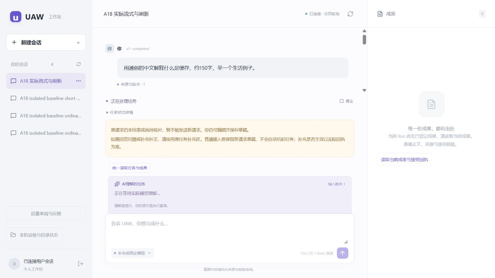

# A18：实际正文增量与分阶段耗时

2026-10-19。工程目标已实现并部署，最终完成以逐项审计/交付提交为准。固定运行 **eeaa6ff815b42f95ff49993e84f8159f7fd6ae48**，原账号入口 <http://127.0.0.1:5183/>。事实质量与本人满意仍独立pending。

## 1. 实际改变

普通回复从固定DeepSeek的真实SSE content提取正文，逐步持久化到原Run/输入/调用绑定的同一Item；原模型/Agent严格最终校验、用量和Run完成规则保持。没有新增分类/理解/自评调用，不展示隐藏推理/提示词/原JSON。正式成果继续生成→核验→登记→等待本人接受。

已修复：同图重复事件读取（7事件SQL10→4）、活动期3秒全量轮询改为250ms增量、HTTP after_seq字符串错配、会话切换期间旧框输入被清空、中断正文/任务理解提示不一致、停止费用待核时本地发送查询锁阻塞新会话。部署实查另修复不同本机实例的无效Cookie阻止登录；401仍拒绝，仅准确同源清理无效Cookie后允许走原一次性入口。

## 2. 测量条件与逐次结果

原版固定69408bc，最新流式实测1cce51e；最终eeaa6ff仅多无效Cookie恢复，Model/Run/Context/网页代码树相同。固定管理员模型deepseek-flash（DeepSeek-V4.1-Flash），输出预留4096、reasoning_level=none及生成提示词未改。隔离合成身份/数据库不含本人记录。服务ready后计时，脚本/进程启动另记，不算网页请求。

固定普通输入：“用通俗的中文解释什么是缓存，约150字，举一个生活例子。”最新两次候选页面顺序执行，随后原版HTTP两次顺序执行；期间没有测试套件/构建并发，但共享机器和旧停止记录仍存在，两组观察方式也不同。首次指当前进程首个样本，不保证提供方缓存真正冷却；重复也不保证命中。只报告实际小样本，不作稳定P95或随机因果比较。

单位：秒；`—`表示未观测。原版HTTP每200ms观察，候选是页面DOM提交属性，均不是物理绘制时间。

| 阶段 | 原版首次 | 原版重复 | 候选首次 | 候选重复 |
| --- | ---: | ---: | ---: | ---: |
| 提交至受理 | 0.273 | 0.229 | 0.200 | 0.233 |
| 排队至认领 | 0.317 | 0.164 | 0.144 | 0.090 |
| 认领至Agent step | 3.336 | 3.334 | 2.703 | 3.123 |
| step至固定Context版本行 | 2.098 | 2.305 | 1.820 | 1.657 |
| Context版本行至模型claim | 2.346 | 2.127 | 1.753 | 1.801 |
| claim至attempt准备 | 0.176 | 0.143 | 0.127 | 0.182 |
| 提供方HTTP至首content | — | — | 1.902 | 0.765 |
| 提供方content生成窗口 | — | — | 0.962 | 1.358 |
| 首可展示正文至COMMIT确认 | — | — | 0.044 | 0.055 |
| COMMIT确认至DOM首次提交 | — | — | 0.178 | 0.080 |
| 首次观察正文 | 15.345（HTTP） | 14.260（HTTP） | 9.125（DOM） | 8.293（DOM） |
| 模型finished至最终正文版本行 | 4.219 | 3.958 | 3.273 | 3.214 |
| 提交至Run结束 | 15.125 | 14.080 | 13.372 | 12.900 |
| 业务模型调用 | 1 | 1 | 1 | 1 |

原始逐Run时刻、持久版本、模型调用和费用见[最终机器汇总](evidence/ms-i2m-a18-final-latency.json)、[DOM计时](evidence/ms-i2m-a18-fixed-browser-timing.json)。Context版本行并非完整函数CPU计时；模型claim、实时权限复查与固定输入准备分开看，不能将整个Gateway墙钟归给提供方。COMMIT确认由首事务返回后采集，进程突失可缺失，缺失不补零。

**提前看见正文已经证实，整体普遍更快尚未证实。** 早期同条件HTTP候选末尾12.052/11.276秒，原版重复10.342秒，曾出现总耗时退步，保留在下方阶段表。最新少量值不足以覆盖这种波动。仍存约6–7秒应用准备和约3秒完成提交开销，是下一轮计数/调用栈诊断对象，不凭猜测删权限复查。

### 正式成果额外成本

最新短报告实际生成1次＋语义核验1次；生成结束至Artifact版本行约3.982秒，至VerificationReport版本行约10.093秒，核验Gateway窗口2.094秒（包括实时来源复查）。实际页面显示正文、逐项核验及“等待你审阅”，未被当成普通reply提前completed。A仅结束合成诊断，没有接受成果。[实际页面/原调用证明](evidence/ms-i2m-a18-fixed-actual-page.json)。

## 3. 恢复、中断与验证范围

- 最新实际页面：生成中刷新，原同一Item从revision1恢复到in_progress/revision28，最终revision29；1275字前缀单调、仅1模型调用。另一次首段到达立即取消，原46字保留failed/revision3、attempt失败、Token末帧和金额pending；原Run可能仍stopping，未重发。之后新会话正式提交成功，旧费用未释放。
- 受控真实SQL验证提供方断连、取消/最终发布竞争、进程失去末帧后新实例恢复、unknown不重发，以及原输入/模型/Item权限绑定。受控浏览器验证重复/缺序事件、刷新、部分失败和本地查询恢复。实际刷新观察到in_progress不必然证明提供方尚未EOF；更细时序由受控测试覆盖。
- 相关最终回归：107模型/契约、129网页单元、50真实SQL、71受控Chromium；最终认证修复23SQL。全部无失败/错误/跳过。只覆盖本轮风险与兼容链路，非全仓验收，不更新last_full。原澄清/同Run回答、纠正、审阅暂停/恢复、原接受合同均在50SQL内复跑。
- 原预览128通过/1固定来源检查失败保留；接口提交363618f后生成器固定来源，129通过，不将preview冒充发布。HTTP探针误判202只读找回原Run，未重发；初次Cookie登录失败、服务工具回合中断及恢复分别记录。

[模型/契约](evidence/ms-i2m-a18-pinned-source-model.xml) · [网页单元](evidence/ms-i2m-a18-pinned-source-web.xml) · [相关SQL](evidence/ms-i2m-a18-pinned-source-sql.xml) · [受控Chromium](evidence/ms-i2m-a18-pinned-source-chromium.xml) · [最终认证](evidence/ms-i2m-a18-final-auth-cookie.xml)。

## 4. 全部新增调用与费用

| 范围 | 实际调用 | 已知输入/输出Token | 中断且Token末帧未知 | 金额未知pending |
| --- | ---: | ---: | ---: | ---: |
| 原版隔离基线/网页及最新重复 | 7 | 16842 / 1092 | 0 | 7 |
| 各流式候选/网页/报告 | 13 | 26618 / 2933 | 2 | 13 |
| 本轮合计 | 20 | 43460 / 4025 | 2 | 20 |

0自动重试，2次隔离测试取消均保留真实raw回执/调用意图/未知费用；已知Token不是完整合计，未知不得填零。A17原8题17调用41392/4916Token和17笔pending独立保留，不混为本轮。服务恢复、登录和只读汇总未新增模型调用。

## 5. 质量与交付

原8题选中回答、引用/修订已逐项读取：[原质量读取](evidence/ms-i2m-a18-existing-quality-read.json)。最新原账号0正式人审、0已提交任务反馈：[当前只读检查](evidence/ms-i2m-a18-current-delivery-check.json)。缺表提示、补充论文后仍索取全文等措辞留给原审阅入口核对，没有据模型自评替本人确定事实正确性。生成提示词/模型参数/决策策略未变，传输与显示修复不宣称事实质量提升。

最终固定277源码、三构建hash、原1209记录、身份、8评测包和12会话核对，匿名审阅401；原账号实际页面已登录，0代任务/评分/原生授权/接受。首次部署的Cookie失败已单独保留，最后工具回合中断后确认进程不存在、原任务空闲，再恢复相同冻结包。[最终部署](evidence/ms-i2m-a18-final-deployment.json) · [初次登录失败](evidence/ms-i2m-a18-initial-login-failure.json) · [服务中断](evidence/ms-i2m-a18-service-interruption.json)。

默认固定用户模型/单Agent，子Agent、DAG、本机写入安装exec与原flags保持关闭。流式仅在当前可信内部装配开启；正式成果等待和实际授权有效期原合同不变。

[本人可测步骤](human-tests/H02-v10.md) · [详细设计/目录](MS-I2m-A18.md) · [接口](../api/STREAMING.md) · [开发计划](../plan/H02_CONVERSATION.md)

保留的早期阶段记录（截至2026-10-18；其中未提交/审批阻断不是当前状态）

# A18 等待体验：已观测结果与未完成项

2026-10-18。原始来源为隔离合成账号的认证网页 HTTP、原持久记录和实际浏览器。没有向本人原任务发送请求、填写评分或接受成果。

## 1. 当前能证明什么

固定管理员模型 `deepseek-flash` 的 SSE 实连成功。普通回复从实际 `content` 解码正文，提前写入同一消息；最终仍由原 Agent/Run 提交。实际页面捕获过 `in_progress` 正文，刷新后读取同一消息完整内容；另一次出字后取消，保留不完整前缀和待核费用。

当前证明了正文可以更早出现。**未证明总完成时间更短，也没有稳定 P95 结论。** 全部新实测金额仍未知，不能当作零成本。

## 2. 比较条件和限制

- 原版运行源码 `69408bca5896d978e58bd280364bb3c972aaeded`，基线网页为 `127.0.0.1:5184`；初次流式 HTTP 候选为 `908727b797b56570d16e163d588bc6707e95cd20`，同样复制原获准模型目录、没有复制本人数据。实际页面随后使用 HTTP 修复版 `d75222693ca9e1c95c571f5d3908a29629295d44`。
- 模型名、输出预留 4096、reasoning_level=none 和生成提示词保持。普通解释仅一次业务调用；正式报告另有原合同的语义核验调用。
- 三个固定输入是“约150字解释缓存”“重复同一问题”和“依据虚构材料写短 Markdown 简报”。先后顺序固定，没有随机分组。
- `ordinary-cold/ordinary-warm` 是原探针样本 ID。基线服务在两题之间恢复过进程，因此不能将它们当作同一进程的严格冷/暖缓存实验；同时存在其他开发测试负载。只能逐项报告当时结果，不能把差值全归于本次代码。
- 先启动服务并确认 ready，再开始网页请求计时。准备脚本、Python/Node 启动耗时不计入下面的提交延迟。
- HTTP 探针约每200ms读取，表中是读取到内容的时刻，**不是浏览器物理绘制时刻**。数据库版本行时间也早于 COMMIT 返回；旧值不冒充真实提交确认。

## 3. 固定样本的逐次耗时

单位为秒，四舍五入；完整毫秒及原 Run/attempt 来源见[机器记录](evidence/ms-i2m-a18-latency-observations.json)。`—`表示未观测。

| 阶段 | 原版首次 | 原版重复 | 候选首次 | 候选重复 |
| --- | ---: | ---: | ---: | ---: |
| 提交至 HTTP 受理 | 0.193 | 0.192 | 0.193 | 0.152 |
| 原队列排队至认领 | 0.268 | 0.367 | 0.084 | 0.298 |
| 认领至进入 Agent step | 2.930 | 2.811 | 2.407 | 2.274 |
| step 至原模型调用 claim | 4.039 | 2.626 | 3.481 | 3.358 |
| Model claim 至 attempt 准备 | 0.159 | 0.092 | 0.159 | 0.115 |
| Gateway 的实际调用窗口 | 2.071 | 2.092 | 2.266 | 1.728 |
| 首可展示文本至首版本行时间 | — | — | 0.015 | 0.016 |
| 提交至首消息版本行时间 | 13.669 | 10.250 | 7.610 | 7.036 |
| HTTP 首次读到正文 | — | 10.317 | 7.667 | 7.172 |
| 模型 finished 至最终正文版本行 | 3.717 | 1.903 | 3.012 | 2.952 |
| HTTP 观测到任务结束 | — | 10.342 | 12.052 | 11.276 |

Gateway 窗口包含实时权限/取消检查及流检查点，不能直接等同于提供方等待。精确的 `provider_started_at/headers_at/first_content_at/last_content_at/ended_at` 和首正文 `first_committed_at` 已加入后续源码；前者受控 SQL 顺序通过，新增 COMMIT 确认字段仍需 SQL 复测，最终版本的真实计时尚未采集。

正式短报告的额外路径：原版/候选均为生成1次＋核验1次。HTTP 读取到登记成果为13.071/16.368秒；核验 Gateway 窗口为2.283/2.241秒，生成结束后至核验报告登记为6.700/7.823秒。这个路径没有变成普通消息直出；登记不等于用户接受，合成报告在诊断结束后取消，未代本人接受。

## 4. 应用自身已经修复的具体问题

1. **反复读取全部事件。** 同样7条事件的真实 SQL 计数从10降至4；保留所有人过滤、缺失/已删除历史拒绝和固定分页水位。活动期读取 `after_seq` 之后的新事件，正文载荷最多4路读取、按序应用；提交、决定、重连先读完整快照。
2. **约3秒才读取一次活动内容。** 活动期改为250ms增量轮询，最终/空闲仍使用原慢速轮询。它是现有网页传输上的增量，不声称 WebSocket/SSE 直达浏览器。
3. **HTTP序号类型错配。** 真实页面发现 after_seq 字符串被严格契约拒绝；已按非负有界整数解析，并保持重复/非法参数422。
4. **新建会话期间输入被清空。** 请求/切换过程中临时禁用输入，避免旧输入框接受文字后被新会话初始化覆盖。
5. **中断仍像在等待。** 不完整正文显示 failed、原前缀保留。停止且无完整理解时不再显示会继续生成理解；当前预览也把实际出字/中断状态传给理解提示。
6. **已停止但待核费用一直占本地发送查询。** 新只读 `stopped_reply_ref` 根据原 job、唯一流/调用、原输入/消息及无工具来源证明停止。它只允许网页释放本地查询，以便新会话提问，不改变原 Run/预算/费用；来源缺失仍不释放。后端两项SQL、预览前端与类型检查通过，**尚未固定发布并整链部署**。

SQL和页面阶段分别见[计数前](evidence/ms-i2m-a18-event-sql-before.json)、[计数后](evidence/ms-i2m-a18-event-sql-after.json)、[39个不同SQL节点所用兼容回执](evidence/ms-i2m-a18-related-sql-path-fixed.xml)、[9项流式边界](evidence/ms-i2m-a18-timing-stream-final.xml)、[71项受控Chromium](evidence/ms-i2m-a18-chromium-final.xml)。这些是分阶段结果，不能证明当前未提交变更已做最终汇合验收。

当前未提交预览的完整前端单元为128通过、1失败：失败是原固定来源检查尝试读取`working-tree-preview`这个非Git发布源。该门槛保留，不将预览改叫发布来获得通过。此前13项停止/理解定向节点通过；当前Python类型、Ruff和TypeScript通过。最新Model/契约本地复跑在受限环境未输出结果，已显式中止，不记通过；此前固定阶段107项通过的范围保持。以上原失败、未跑完和待门槛都属于交付审计的一部分。

## 5. 全部实测用量与费用

| 范围 | 实际调用 | 已知输入/输出Token | 失败或中断 | 金额未知pending |
| --- | ---: | ---: | --- | ---: |
| 原版隔离基线及网页样本 | 5 | 11808 / 822 | 0模型失败；另有3个探针准备/观察失败 | 5 |
| 流式候选及实际页面 | 7 | 14726 / 1458 | 1次A隔离测试取消；该次Token末帧未知 | 7 |
| 合计 | 12 | 26534 / 2280，另有1次Token未知 | 0重试；中断保留原SSE与预留 | 12 |

“合成取消”由A在隔离测试身份执行，并非本人真实任务。上表已知Token不能当作完整合计，未知末帧不能补零。A17原8题17调用及其待核费用全部保留，未重复运行，也未混入本表。

## 6. 质量与恢复证据

已重新读取原8题的实际选中回答、引用和修订回执，摘要见[读取记录](evidence/ms-i2m-a18-existing-quality-read.json)。办公样本的额外缺表提示、论文补充后仍索取全文的措辞等保持可供本人审阅；本轮未更改生成策略、未代填事实判断。页面/传输修复不等同于事实正确率提升。

约600字实际回答捕获过部分正文，刷新后相同消息到最终revision21；没有第二次模型调用。约800字实际回答在出字后停止，原169字前缀留存failed，usage未知且费用pending，没有重发。受控进程突失用真实SQL重新创建队列，原claim不会重发，前缀转不完整；这与真实提供方中断分别记录。

实际页面与原SQL版本的对应见[页面证据摘要](evidence/ms-i2m-a18-actual-page.json)。刷新后的完整结果已观察，不能仅据两次快照宣称刷新一定发生在提供方EOF之前；这个更精确的时序仍由受控浏览器验证。

## 7. 当前交付停止点

最后已提交阶段是 `65be065ece4fe8150e226c577e1ce53e12d2ad1e`。H02-v10仅做过准备，**没有完成原账号切换、最终实际页面验收和正式交付**。后续停止证据/显示/COMMIT计时和本文档仍是未提交变更；网页生成来源明确标为 working-tree-preview，不能作为固定发布。

Git暂存请求被自动审批服务拒绝执行，原因为审批服务自身使用额度耗尽、审查未完成，不是动作被认定不安全。没有改用其他手段绕过。需要审批服务恢复后固定接口SHA、按该SHA重新生成网页、完成相关SQL/浏览器回归和实连计时，再部署并逐项审计Goal。原账号历史/人审/预算未因此更改。

[详细设计和目录](MS-I2m-A18.md) · [接口](../api/STREAMING.md) · [待部署测试步骤](human-tests/H02-v10.md)

