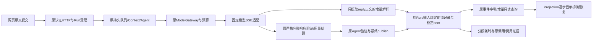

# A18：普通回复流式显示与网页端到端耗时

2026-10-18。工程起点 `9ad685c3c99492e0fc68af52a4595d1e903bfdce`，H02-v9冻结运行源码 `69408bc`。本轮由A独立实施，不派发或操作BCD，不启用子Agent/DAG/本机写入安装exec。A17的审阅、反馈、原评测器及8题结果直接复用；本人事实判断继续pending。

## 1. 已证实的缺口

- `model/adapters.py`明确发送`stream:false`，等完整响应才解析，没有向消息发布正文增量。
- `ModelGateway`保留原一次发送、预算、取消/撤销复查和原始响应；流式必须沿用这些边界。
- `conversation_entry.publish`只在原模型/Agent最终校验后创建稳定消息并完成Run。增量不能提前触发这一完成路径。
- 网页`controller.ts`每约3秒完整读取条目、事件历史、各事件正文及Run/Frame；这会延迟显示，是否是主要耗时须实际测量。
- 已有`InteractionItem`、`item.updated`/`item.delta`、单调事件序号及页面Projection，优先扩展现有机制。

提供方公开[Chat Completions文档](https://api-docs.deepseek.com/api/create-chat-completion/)描述SSE正文delta、`[DONE]`及末帧usage；这只能证明公开协议，当前管理员实际endpoint、固定模型别名和返回形态仍需实连。`reasoning_content`不进入用户正文，不能静默换模型。

## 2. 模块、目录与联系

| 模块 | 计划目录 | 详细策略 |
| --- | --- | --- |
| 提供方流式 | `src/uaw/model/streaming.py`、`adapters.py`、`contracts.py` | 有界UTF-8/SSE解析；逐帧校验模型/choice/身份；只接content，忽略推理；保留真实SSE原始字节和真实usage，最终仍走原严格解析 |
| 正文提取 | `src/uaw/model/stream_text.py` | 解析原conversation-v1 JSON字段，不展示JSON；确认protocol和action=reply后才释放text前缀；处理字段乱序、转义、分片Unicode、重复字段及截断；ask/tool/deliver不伪装普通回复 |
| 流持久化 | `src/uaw/run/streaming.py`、`src/uaw/shared/streaming.py` | 一个原invocation/输入版本关联一个流；稳定消息ID与原publish一致；有界合并检查点，原会话事务提交Item和事件；增量只是in-progress |
| Model接线 | `model/gateway.py`、`agent/assembly.py`、`model/ports.py` | 可选可信流端口，仅原conversation-v1根Agent；保留原claim/dispatch/预算/取消/授权/原deadline；旧适配器与非流式调用兼容 |
| 完成与恢复 | `run/conversation_entry.py`、`background.py` | 最终模型和Agent来源全通过后，在同一稳定Item完成并提交Run；中断/取消/旧输入标不完整；重启只恢复原记录，unknown不重发 |
| 增量读取 | `run/events.py`、API及契约源 | 原认证事件读取增加可选after_seq；固定页水位、排序、分页和所有人检查；读取无执行副作用，不从头反复拉取历史 |
| 网页 | `lib/api/client.ts`、`lib/events/projection.ts`、`features/workspace/` | 初次/重连读完整快照，活动期读新事件；按序号和Item修订幂等应用，缺序回快照；真实正文逐步显示，失败不标completed；后台/完成后降低轮询 |
| 测量与回归 | `ops/`、`tests/unit/model/`、`tests/integration/`、`apps/web/tests/` | 固定少量原问题和配置，通过认证网页HTTP及实际页面测量；受控断线/取消/重启另记；用原A10–A13汇总全部调用与pending费用 |

## 3. 对象、接口与生命周期契约（实施前策略）

新增严格流记录须包括：原Run/conversation、input_revision、原invocation与provider attempt、原Agent operation、稳定item_id、context snapshot/model配置绑定、状态、正文检查点、首内容/末内容/接收完成时间、修订及失败来源。准确字段以本轮`shared/streaming.py`和契约生成源为准，不能在网页参数中私加授权或模型覆盖。

提供方请求仅增加可信内部流回调/选项，不由用户原文决定。实际支持和管理员装配验证后才对相应运行入口启用；其他调用仍走旧路径。普通问答不增加分类、理解或自评调用，模型参数与生成提示词保持，流式是传输改变。

状态链为原发送准入→接收→正文检查点→模型接收完毕→原Agent/最终publish。模型接收结束不表示Run完成。原最终完成事务必须重新验证Run/input、原ModelOutput/用量、Agent操作、取消和权限，才能将同一Item置completed；正式成果继续走原Artifact/Verification/接受。

每次持久检查点重新核对原Run/input与调用身份，事件单调。读取完整Item文本/修订可恢复任意分片；不会因事件重放拼出重复正文。网页断线只读恢复，不能重发模型；进程失去末帧则保留原发送意图及unknown费用，不复活旧调用。失败或取消应保留已显示的原前缀并标未完成；不把截断JSON或未核验增量变为正式答案。

增量JSON解析不改变最终合法性：字段次序不限，只有protocol=conversation-v1且action=reply才允许显示已解码的text。若前置条件尚未出现先缓冲；后续重复/非法字段、变化或截断由原最终严格校验拒绝。不得为更早显示修改提示词强迫输出另一套业务流程，不接收推理或工具参数为正文。

事件读取的after_seq为非负整数，首次读取默认0；有分页cursor时水位、起点和身份由签名cursor绑定，不允许更换参数跨页拼接。超前序号、缺失历史和错用户明确失败，前端恢复原快照；新增字段兼容旧调用。

## 4. 耗时与比较契约

### 3.1 内部端口与记录字段

| 入口 | 输入 | 输出/约束 |
| --- | --- | --- |
| `ModelStreamPort.open` | 原`ProviderRequest`、`TrustedExecutionContext`、原invocation_id | 当前conversation-v1 Agent的`ModelStreamConsumer`；非本入口返回None，不影响旧调用 |
| `ModelStreamConsumer.content` | 该次真实SSE的content字符串delta | async完成检查点；不接reasoning字段；原期限/取消仍由Gateway复查 |
| `ModelStreamConsumer.finish` | 原`ProviderResponse`或原失败code/category | 接收完成或中断记录，不完成Run；失败无自动重发 |
| `ReplyText.feed` | 任意分片的原conversation-v1 JSON content | 已确认reply的解码正文前缀；字段未齐返回空；无工具执行或状态提交 |
| `EventReader.read`新增`after_seq` | 非负整数，默认0 | 原EventPage与签名分页；cursor已固定的序号不能被新参数覆盖 |

计划严格`ConversationStreamRecord`：`id`为原invocation；`revision>=1`；`run_id/conversation_id/operation_id/item_id`为稳定ID；`input_revision>=1`；`attempt_id`为实际提供方attempt；`snapshot_ref/model_config`为原固定来源；`state`为receiving/received/interrupted/published；`text`为至多65536字符已允许的正文前缀；`created_at/updated_at`为UTC；可选`first_provider_at/first_text_at/received_at`、`output_ref`、`failure_code`，以及非负整数`provider_chunks/persisted_chunks`。具体实现若需要调整，先同步此策略及严格契约源，不在调用中夹带私有字段。

稳定Item使用原`conversation-message-`算法和原Agent operation，不以网络连接创建新消息。Item为原InteractionItem，正文检查点使用in_progress，原完成publish使用当前修订+1并保留created_at；只有最终publish增加正式来源refs。未收到合格reply时不创建空白假回答；原始SSE与失败用量仍由Model域保存。

固定基线为原H02-v9源码，准备独立合成身份/数据库和持久服务，只复制获准平台模型目录，不复制本人任务或评分。所有测量在服务启动并就绪之后开始，记录冷/暖样本顺序；启动脚本耗时单列，不当成网页处理时间。

测量点：浏览器/HTTP提交开始、HTTP受理、队列各阶段、Context准备、模型发送、首提供方content、首可展示reply文本、每次持久检查点、事件读取/页面可见、最终模型/Run与正式成果核验。端点和浏览器时钟分别使用单调时钟，不跨进程相减单调时间；跨进程事件使用已记录UTC且说明误差。未观测的阶段记缺失，不能估算成0。

少量样本只报告逐次值、范围和条件，不发布稳定P95。普通问答、必要澄清、正式文本各有固定练习输入；取消/断线/重启以不影响本人工作的隔离场景验证。原8题可读但无人审，不借本轮传输改动宣称事实质量改善。若进一步修改生成策略，先登记新条件，再用原评测器比较。

## 5. M1–M4退出条件

1. M1：实际服务/配置与已提交反馈只读核对，详细设计/字段/目录固定；基线真实网页请求分段记录、固定模型SSE能力验证及全部费用保留。
2. M2：有界SSE/正文提取、原调用与稳定Item、认证事件读取及实际页面增量贯通；受控安全边界通过。
3. M3：按测量定位并修复应用瓶颈，保留同条件前后值；按具体反馈修复，缺人审不代填。不能用调大deadline/放松校验掩盖问题。
4. M4：相关澄清、纠正、取消、重连、报告审阅接受兼容回归，固定新源码部署，原账号/历史/未保存表单保留，交付可测清单与逐项审计。

当前仅完成现场阅读和设计，尚无真实SSE验收、耗时收益或新部署结论。后续每阶段追加真实回执，旧失败和费用不覆盖。
