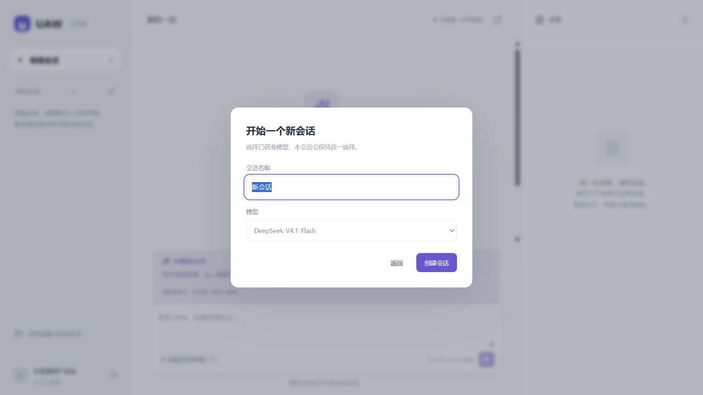

# H01-v1：办公／学术文本人工体验

2026-10-13，**已启动、真实预跑和页面登录完成；等待本人体验反馈。**

## 从哪里开始

[体验页面](http://127.0.0.2:5181/)已在右侧浏览器登录，停在“开始一个新会话”。
点“创建会话”后写自己的问题；保留同一浏览器页面即可刷新。
新浏览器或退出后需新的限时本机登录入口，普通链接不会替代登录。

建议先试三件事，也可自由提问：

1. 粘贴一段会议纪要，要求整理负责人、时间和待定事项。
2. 粘贴两段观点或研究材料，要求比较依据、差异和无法确定的结论。
3. 刷新页面看看任务和成果是否还在；也可用新任务体验取消、审批拒绝。

成果出来后查看正文和逐项核验；满意时由本人点接受。任何测试操作都不自动算认可产品。
本轮可以测文本任务、材料理解与成果阅读。本机文件、联网搜索、子Agent、DAG、写入／安装／exec仍未开放。
不要把本机状态中的连接当作本轮文件读取成功门槛。

反馈直接发到 A 聊天即可：哪个页面或步骤、原来期望什么、实际怎样、有无截图。
不必整理成技术报告；遇到难懂文案、等待太久、结果不满意也都记录。

## 已知问题

- **等待偏长**：两个小样例从受理到生成成果分别约140和133秒；后续核验和本人接受不在此数字内。
  已登记为优先诊断项，不宣称速度合格；两个样本不能推断所有任务的耗时。
- 原本机文件首次链仍停在签名候选已保存、正式回执未发布，不纳入本轮成功体验范围。
- 本人可用性反馈、自由场景、人工审批拒绝／取消和成果接受仍待本人执行；工程预跑不代替这些结果。

## 固定版本与隔离

| 项 | 实际来源 |
| --- | --- |
| 后端 | `ms-i2l-a29-source` / `c905ec26e4d25c11b0af991f1e725a279cceb439` |
| 体验版本标签 | `human-h01-v1` 指向同一源码，不跟随 integration 浮动更新 |
| 前端 | 已接受的 MS-U3b / `394d78579bb6841bd936b11af557bc401d0b2dba` 原三文件构建，逐文件摘要核对 |
| 运行目录 | `E:/UAW/.data/human/H01-v1/runtime`，准确commit导出的独立源码快照；不是共享worker目录 |
| 后端／页面 | `127.0.0.2:8011` / `127.0.0.2:5181`，精确Host/Origin；第二回环地址隔离原Cookie |
| 数据与身份 | 新数据库，独立登录／分页／浏览器密钥、blob与日志；只复制平台目录版本，不复制原聊天或授权 |
| 依赖 | 原锁定依赖复制为独立91包site-packages；原CPython3.14.6缓存作为不变基础解释器 |
| 模型 | 当前管理员批准的固定 DeepSeek-V4.1-Flash / deepseek-flash，OS保管凭据；未替换模型 |

预跑和本人体验使用独立身份，预跑原数据库记录保留；本人空间初始为0条用户记录。
切换身份与隔离依赖的准备停启均在本人尚无Run时检查，未中断本人任务；登录刷新仍成立。
不会自动关闭本轮页面或跟随新提交重启。后续修复要重新固定版本并记录复体验。

实际配置、数据库名、PID、原私有回执在忽略的`.data/human/H01-v1/`，不提交凭据、Cookie、launch秘密或原完整材料。
密钥与元数据配置按原Settings/OS来源；没有为体验放宽权限、审批、期限或flags。

## 实际准备回执

- 27个代理／配置用例通过，215源码类型及4文件静态／格式检查通过；不是本轮全量。
- 实际TCP登录、匿名拒绝、错误Origin拒绝、固定模型目录、原请求只读查回、成果正文/hash／逐项报告、事件与再次读取通过。
- 办公：真实行动清单与待定事项；学术：区分相关／因果和选择偏差，两个后续验证方案。
- 每个样例3次真实模型调用，共6次，输入13743／输出2909 Token；合计1.50 USD为账本待结算预留，**不是实际账单**。
- 两份成果逐项核验succeeded，仍等待原会话的用户接受；没有代点接受、native确认或触发本机文件读取。
- 原准备失败均保留：临时目录、IPv6连接、Mypy源码根、预跑解析403与202状态。原办公202受理后只查回原Run，没有重发。
- 当前真实页面显示已连接身份；刷新保持，模型对话框实际显示DeepSeek-V4.1-Flash。

[完整脱敏回执](../evidence/ms-i2l-a29.json) · [人工体验计划](../../plan/HUMAN_TESTING.md) · [A29接线说明](../../coordination/requests/A/MS-I2l-A29-human-environment.md)

## 本人反馈／接受记录

| 项 | 当前状态 |
| --- | --- |
| 本人体验 | awaiting_user；未收到反馈 |
| 本人是否满意 | 未判断 |
| 本人是否接受成果 | 未操作 |
| 本轮MS-I2l整轮接受 | pending，文件链与汇合全量仍未通过 |

