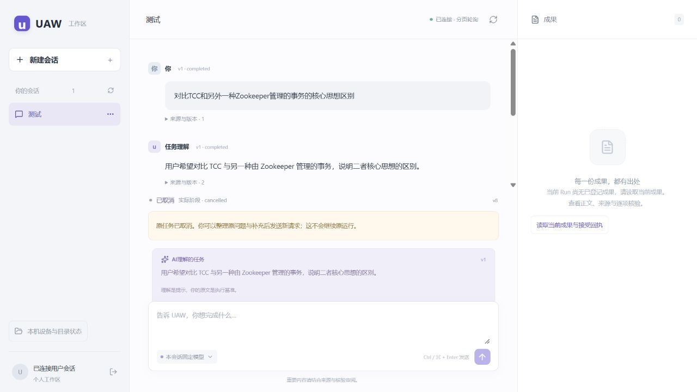

# H01-v2：等待问题可见，继续本人体验

2026-10-13，固定源码 `ms-i2l-a31-source` / `b43f3d06d2fbcb1595de4d1fe23f4e9a7580a4bf`。

## 入口与这次变化

[打开 UAW](http://127.0.0.2:5181/)；已在当前聊天旁打开并登录原账号。

- 模型需要补充信息时，显示它原本提出的具体问题。
- “等待你确认”改为“任务等待处理”；实际审批、成果接受仍有各自操作。
- 新任务只显示一份任务理解。
- 草稿能继续编辑；需要重新提问时，说明须先停止、读到已取消，再发送新请求。

当前还不支持在同一个运行内提交澄清。原任务已经取消，可以整理原问题与补充后重新发送。
旧记录中的重复理解保留为历史；没有回填回答，也没有重发或复活旧任务。

## 实际启动与验证

A31包含A30原问题发布修复和B准确最终源码 `db0a6981c1c925ad46283c765cef5a08d2c8cfcf`；
B独立交接 `c13232bd8b8af813e448c14b8d39b8e4789662ba` 已完整合入。

沿用原H01数据库、用户、OS认证来源、聊天和blob路径；旧H01-v1源码/dist不改。
新版本以独立源码与三文件构建快照启动，锁一致，读取原H01独立依赖环境；没有覆盖旧依赖。
原服务已停止且没有活动本人Run，才启新版本；数据库容器停机导致的准备超时已记录，原A容器已恢复。

真实localhost Agent ready、HTTP三文件hash、匿名拒绝、原用户登录与刷新读取原cancelled v8已核对。
页面显示新取消指引，原问题/聊天与固定模型来源保留；没有代点发送、停止、审批、接受或native。
刷新首个初始化画面不计丢数据，实际列表加载后已核对原会话。

A30后端8个不同实际SQL节点及215源码类型通过；B82单元和43受控Chromium最终通过，未重复计数。
受控回复和受控浏览器不代表真实模型质量或本人满意；本版没有新增真实模型调用。
原本人任务两次模型调用的0.50 USD是pending预留，原费用/失败记录保留。
首次本机文件发布/恢复仍未通过；旧全量记录保持，不标整轮accepted。

## 本人复测建议

1. 重新提出一个你真正想完成的问题，查看回答是否清楚、有用。
2. 如模型需要补充信息，确认具体问题能够看到，等待说明是否明白。
3. 刷新后确认聊天和草稿保持；看不懂、等待太久或没有结果时直接反馈。

[准确接线与回执](../evidence/ms-i2l-a31.json) · [原反馈与原因](H01-I01.md)
