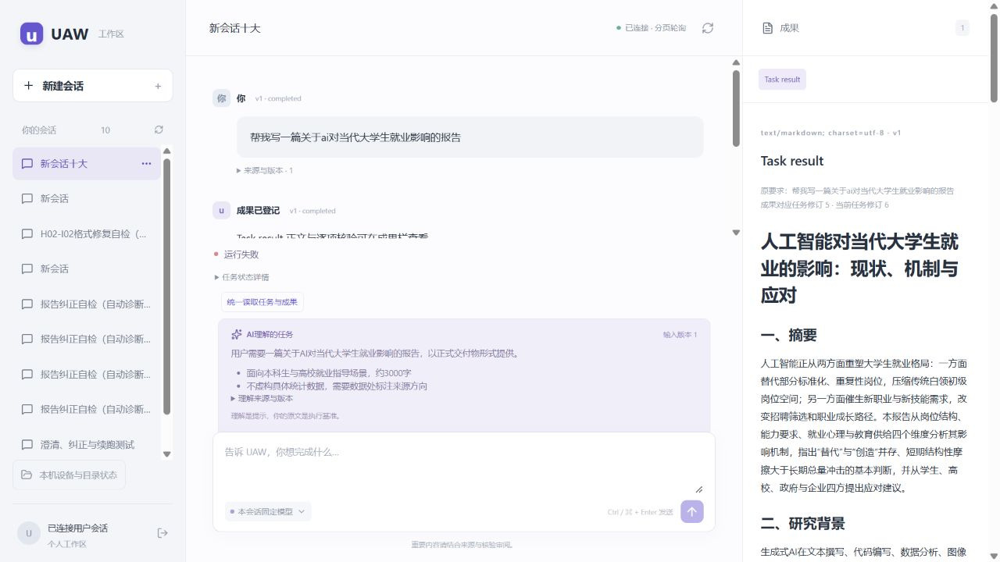

# H02-I03：报告已经就绪，主界面仍显示运行和等待理解

2026-10-18。本人反馈会话 `conversation-6702653d5e0a45159a1eee55d171ab2f`，原任务 `run-169ef7763d694cc297c00b51dea9e6b4`。

## 原因

两处读取的是同一任务、同一输入和 Run 修订5。原模型已经返回报告及理解摘要，后续核验也已结束；后台处于 `delivery/waiting`，等待本人审阅。为了保留原成果提案绑定的版本，Run 仍为 `running`。旧页面把这个执行记录直接翻译成“努力奔跑中”，又只从不含摘要的 TaskFrame 读取理解，因此同时出现了两个错误提示。

这次不是模型还在生成，也不需要用户重新发送。原报告、原提案、失败历史和费用均保留；不能为了显示文案把任务改成已完成或替本人接受。

## 修复分工与实际进展

- A15 已固定为 `ms-i2m-a15-source / 3f10b6af27ed5f56a726a7bafe8ee1d083f2bd2b`。新增只读 `GET /v1/runs/{run_id}/presentation`，同一只读快照返回原 Run、输入版本、实际模型理解和当前成果引用。完成、取消受理、待审阅及收尾各自区分。
- H02-v6 已部署实际后端，沿用原账号、数据库和 cookie。原任务的认证 HTTP 返回 `awaiting_acceptance`、`understanding=available`；8个原 Run/消息/决策/成果相关 payload 核对不变。0新增模型调用，0代替用户停止、重发或接受。
- B 已收到本人明确授权的具体修复单，在原分支消费准确 A15 接口。前端需统一主界面、理解与成果入口，保留原接受合同；交付后由 A 审阅和装配，当前不将组件或接口通过当页面已修复。

## 重测范围

原任务应显示“成果已就绪，等待你审阅”，理解卡显示原模型的真实摘要。刷新不能变成假完成；成果正文和接受按钮继续按原提案重查。补充纠正后不把旧成果当当前成果；已受理取消仅显示正在停止，真正终态以原 Run 为准。

A 的10个不同真实 SQL、249源码类型及契约校验已通过，原失败记录保留。B 定向组件、实际页面和本人满意分别登记；准确回执见 [A15证据](../evidence/h02-i03-a15.json)。

## 实际页面观察限制

A 复查实际本机网络时，8013 ready 与 5183 均为 HTTP200；默认隔离检查的连接失败不是服务退出。当前内置浏览器 tab 标题为“无法访问此站点”，绑定观察被浏览器 URL 协议策略拒绝。A 已停止该浏览器动作，没有换浏览器、间接请求、创建新认证或绕过策略。真实原 Page 验证暂待本人刷新恢复访问；后端与受控测试继续，未把该限制写成页面通过。

本人手动刷新后，A成功读取原Page并保存旧页面证据。跨轮后该Page已关闭，A在同一浏览器以原cookie重新打开准确原会话地址，没有新认证或模型请求；不能把新Page冒充同一Page对象。

## 最终装配与实际复验

B最终源码 `af3889f209054b2485aa5ff7aeab6479878342b0`、独立交接 `6e4b21b86c3d8966d11e5a9f363b0650f21eec30` 已普通合入。115不同单元、66不同受控Chromium、类型/构建/生成一致性通过，原失败及各次构建保留，不累加重复用例。A重新核对最终XML节点/hash、准确三文件构建和生成DTO匹配真实HTTP响应，随后只切换5183前端，后端继续原A15，不替换用户数据库/认证。

实际页面和刷新后均读到原模型理解摘要与假设、原报告全文；不再显示“努力奔跑中”或“等待实际任务理解”。技术状态默认折叠，历史成果接受禁用。原输入/决策/消息/登记/提案/Bundle共7个来源payload逐项未变，原Run仍只有2次模型调用，本单新增0。截图如下，真实验收范围见[汇合回执](../evidence/h02-i03-ab-final.json)。

## 新发现：审阅等待期间超时

原Run随后被既有后台以 `background_deadline_expired` 结束，变为failed/v6；这是等待本人审阅也继续计入执行时间的另一个后端问题。当前新版正确显示真实失败与原理解，报告对应旧修订5只能查阅，不能恢复成待接受或把核验succeeded冒充整个任务成功。[H02-I04修复计划](H02-I04.md)列为下一优先事项。

本单没有延长期限、暂停旧时钟、复活任务、重发模型或代替本人接受；显示修复组件已接受，H02产品整轮和本人满意仍未接受。
