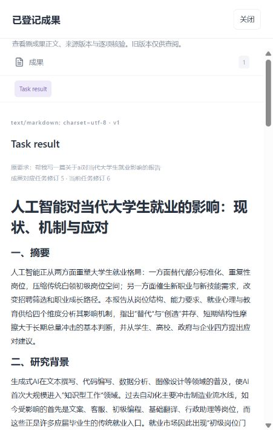

# H02-I04：成果已生成，等待审阅却耗尽执行期限

2026-10-18。原会话 `conversation-6702653d5e0a45159a1eee55d171ab2f`，Run `run-169ef7763d694cc297c00b51dea9e6b4`。状态同步修复过程中观察到的独立问题；本轮本人要求全部由 A 完成，未派新 worker 包。当前修复与真实诊断已完成，H02-v7 已部署，**本人重测仍 pending**。

## 已确认的事实

原Run/v5的报告、核验与提案已经生成，模型调用均结束，job为delivery/waiting，实际等待本人接受。现有主动时钟仍运行。恢复原服务后，后台按原期限写入 `background_deadline_expired / Run execution time expired / admission / timeout`，Run变为failed/v6。原报告、模型理解、输入和两次调用保留，未被重写为成功。H02-I03新版当前按真实失败显示。

原题本身并未再次生成失败；是已经有报告的任务在等待审阅时超时。先前“用户等待不耗主动执行时间”对澄清问题已有实现，不能据此宣称正式成果接受等待也已支持。

## 下一轮目标、模块和目录

| 里程碑 | 负责模块/目录 | 具体处理与交付 |
| --- | --- | --- |
| M1 原来源固定 | A：`src/uaw/run/background.py`、`clock_ports.py`、完成控制与当前交付Reader | 用原Bundle/Contract/Report/Proposal/Run/input核对证明这是有效本人审阅等待，要求无未结外部效果；不能按单个waiting字符串或Artifact存在性暂停。先固定给时钟所有者消费的准确来源协议。 |
| M2 计时与恢复 | 本轮 A 获授权修改原时钟组件及消费 | 原子登记审阅等待与剩余主动额度；等待跨墙钟/重启不重复计时。接受或纠正后仅在实际需要执行时恢复剩余额度，不修改已发送模型/工具的原deadline，不复活终态任务。 |
| M3 接受/修订/取消 | A完成控制，复用已交付B页面 | 用户接受前重查原身份、提案版本、当前权限、取消和未知效果。授权或审批的有效期独立计时；失效必须明确拒绝，不能借暂停继承旧权限。拒绝/取消/修订使旧提案失效，保留历史正文。 |
| M4 实际重测 | A隔离诊断与本人H02体验 | 新Run生成报告后等待超过主动预算对应的墙钟长度，再按原剩余额度接受/纠正。记录全部模型调用、费用、失败及unknown；重复接受、回复丢失、重启及取消竞态保持原幂等。 |

## 必须通过的边界

- 仅当前完整并已核验的本人审阅等待可暂停主动计时；模型、工具、预算预留或未知外部效果尚未结清时不得伪造等待。
- 人工审阅不应靠高频轮询持续改写job/CAS；后续实现须说明唤醒与恢复方式，并保持有界后台工作。
- 暂停不是延期已发命令，不重置执行预算、费用、审批/目录授权或浏览器身份期限。
- 新样例证明修复，不重跑或修改本次已失败Run来制作成功证据。报告核验、原Run完成、本人接受与事实质量分别报告。

## 当前结论

已补齐真实成果来源、时钟暂停/恢复、job停放/有界唤醒和当前权限复查。准确部署源码 `d2000f958dc8f5652a38fbf18f4e6af15020166a`，原 B 前端 `af3889f209054b2485aa5ff7aeab6479878342b0`，H02-v7 沿用 5183/原账号/数据库。旧失败 Run/v6 与报告保持原样，新修复只对新任务生效。

- 初版实际任务主动执行14498ms、等待80782ms，超过原约90秒期限后接受完成，2次模型调用，等待/接受未增调用或续领预算。
- 当前版本实际普通回答1调用；同Run澄清/答复2调用；短周报、跨原期限退出/新进程恢复、纠正和接受4调用；取消等待问题1调用。新旧报告和原主动额度保留。
- 学术A/B模拟材料报告2调用，实际材料标签和来源读取通过，超过原期限后接受完成。模型核验不等于学术事实已人审。
- 全部真实诊断合计18调用，包含首轮脚本失败和短报告误分流；模型协议/传输失败0，费用金额未知/pending不按0处理。原题短报告误走reply，已补充提示词并用原题复测；没有关键词路由或额外分类调用。
- 实际浏览器复用原cookie，旧报告和理解刷新可读；只新增空白体验会话，没有代发用户任务、确认目录或接受用户成果。原999条用户记录逐项核对保留。

工程回归、准确来源、所有失败及费用见 [机器回执](../evidence/h02-i04-a16.json)。设计/目录见 [A16](../MS-I2m-A16.md)，输入输出和约束见 [内部契约](../../coordination/requests/A/H02-I04-A16-review-wait-contract.md)，本人步骤见 [H02-v7清单](H02-v7.md)。B/C/D停止点不变，不新增本机权限、子Agent、DAG、写入、安装或exec；H02整轮、本人满意和独立事实质量继续未接受。

