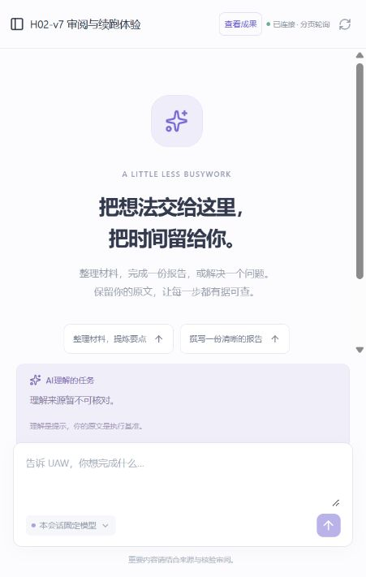

# H02-v7：本人体验清单

2026-10-18。后端冻结 `d2000f958dc8f5652a38fbf18f4e6af15020166a`；前端沿用已验收 B `af3889f209054b2485aa5ff7aeab6479878342b0`。当前是可测试版本，**本人满意、成果接受和独立事实质量尚待本人反馈**。

## 入口

[已登录的空白体验会话](http://127.0.0.1:5183/?conversation=conversation-142272e7703a4494bc5326def8e203ab)。原账号与历史沿用；固定模型 DeepSeek-V4.1-Flash。A只创建了空白会话，没有代发任务、确认本机权限或接受你的成果。

## 建议按这个顺序测试

| 功能 | 可以这样试 | 应看到什么 |
| --- | --- | --- |
| 普通交流 | “用简单的话解释什么是迭代。” | 直接回答；不要求接受成果，不固定再做理解和自评调用。 |
| 小歧义 | “对比TCC与ZooKeeper相关事务的核心区别，先说明你的理解。” | 给合理假设、区分概念；不因一个术语不清就完全拒绝帮助。事实是否正确仍请核对。 |
| 澄清并继续 | “请把这段内容翻译成我指定的语言。”随后补充英文及原文。 | 先问缺少的原文/语言；在原任务回答区补充后接续，不用停止重发。 |
| 简短报告 | “根据这些材料写200字工作周报：访谈5人，需求12项，2项待确认，下周复核。” | 在“查看成果”中有实际报告，核验后显示等待审阅；短报告也进入成果流程。 |
| 纠正原成果 | 在原任务补充区写“下周计划改为周三前确认那2项需求”。 | 显示收到与实际生效；同一任务产生新版本，旧报告仍可查。不要发在普通新请求框中。 |
| 等待后接受 | 报告就绪后先离开一会，再回来查看并自行接受。 | 等待不耗主动执行额度；接受后直接完成，不重写报告。工程实测已覆盖超原期限，不需要你额外等待一小时。 |
| 刷新 | 在澄清、等待审阅或接受后刷新。 | 还原实际问题/当前版本/状态，不自动重发模型或工具。 |
| 取消 | 在等待澄清或审阅时点停止。 | 停止后不能再提交旧成果；原正文和记录保留。 |
| 学术材料 | 粘贴两段摘要，要求分别比较主张、证据和局限，用材料A/B定位。 | 输出对应材料的报告与来源；不能杜撰论文、网址、数据或声称已联网。 |

## 当前进度与限制

- 已接通：普通回答、同 Run 澄清/纠正、剩余执行额度恢复、文本/Markdown 成果、逐项核验、审阅暂停、接受、取消及历史读取。
- 当前修复：等待审阅耗尽期限；简短报告偶尔误走普通回复。真实样例与工程回归分开记录，单个样例不能保证所有任务都正确。
- 继续待验：你本人体验、固定题集的人工事实核对与可比质量评测；完整本机文件链和 Tool 长墙钟另行验收。
- 尚未开放：子 Agent、DAG、本机写入、安装和 exec；联网搜索、外部应用及文件格式能力按后续计划建设。
- 模型费用金额尚不全，pending 保留；“核验通过”不等于事实已被独立证实。
- 原来超时的那份报告仍可读，原任务保持失败，新修复不复活旧任务。

遇到问题请保留会话地址，说明发送的内容、你预期的结果、实际情况；截图可附上。无需先删除、重建或重复发送。A将登记问题、修复并安排复体验。

## 下一阶段

1. 先收集上述真实体验，优先修复阻塞和不必要等待。
2. 完成人工核对的小型事实样本及答案审阅，分别统计错误、漏判和不必要阻断。
3. 完成办公/学术文本整体验收，再推进联网、文件或子 Agent 的独立阶段。

具体来源、失败和用量见 [A16 回执](../evidence/h02-i04-a16.json)，设计和目录见 [A16 实现](../MS-I2m-A16.md)。
