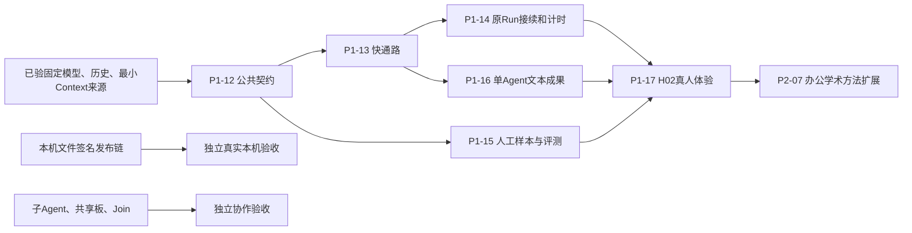

# 2026-10-19：A18固定H02-v10，进入本人体验

A独立完成本轮必要前后端/接口/验证，未派发BCD或启用子智能体。准确运行 **eeaa6ff815b42f95ff49993e84f8159f7fd6ae48**，保留原固定模型、单Agent、质量审阅/反馈/评测器。实际 <http://127.0.0.1:5183/> 已登录原账号，原1209记录/12会话/8评测包保留。

| 模块—阶段 | 已完成任务与目标 | 目录与退出证据 | 后续任务 |
| --- | --- | --- | --- |
| Model/Item—M1/M2 | 真实SSE、有界正文提取、稳定Item、原最终校验/费用；首HTTP/content/提交确认计时 | `model/streaming.py`、`stream_text.py`、`run/streaming.py`；107模型/契约及50相关SQL | 依本人具体反馈定向处理兼容性，不静默换模型 |
| HTTP/页面—M2/M3 | after_seq、活动250ms轮询、事件批读10→4SQL、刷新/重复事件恢复、取消不完整提示、停止后新会话 | `run/events.py`、`api/routes.py`、`run/presentation.py`、`apps/web/`；129单元、71受控浏览器、实际页面证据 | 本人体验出字、刷新、停止和新会话 |
| 质量—M3 | 读原8题及当前反馈；无新人工标签，无生成策略改动 | 原`run/quality.py`、`evaluation/`；读取摘要与当前检查 | 本人提交事实判断/具体问题后定向修复；策略变化前登记比较条件 |
| 计时/费用—M1/M3 | 固定少量顺序样本，精确提供方/提交/DOM时刻，全部20次调用及2次未知末帧 | `ops/summarize_stream_latency.py`；A18-LATENCY和JSON | 优先分析仍存的约6–7秒应用准备与约3秒完成提交，优化前保留计数/条件 |
| 部署/本人—M4 | 固定277运行源码、三资源hash、原账号/历史、匿名401和实际登录页面；无效Cookie同源清理23SQL | H02-v10测试步骤、部署/服务恢复记录 | 本人体验及8题人审，A不代填、授权或接受 |

工程验收按实际范围，不更新last_full，不把传输改善当事实正确率或满意度提升。旧预览失败、审批未执行、登录/服务中断证据全部保留。子Agent/DAG/本机写入安装exec与flags关闭；P1-15/P1-17产品整轮继续pending。下方为历史。

[设计及目录](../implementation/MS-I2m-A18.md) · [耗时/限制](../implementation/MS-I2m-A18-LATENCY.md) · [本人可测清单](../implementation/human-tests/H02-v10.md) · [准确派发状态](../coordination/DISPATCH.md)。

# 2026-10-18：A17 工程交付，H02-v9进入本人审阅

本轮由 A 独立完成必要后端、前端和评测，未派发或操作 B/C/D。M1详细设计与严格契约、M2认证持久草稿/正式导出及独立Run反馈、M3固定8题17真实调用、M4实际视觉修复与H02-v9部署均有证据。[完整策略/字段/目录](../implementation/MS-I2m-A17.md) · [本人测试](../implementation/human-tests/H02-v9.md) · [Goal逐项审计](../implementation/evidence/ms-i2m-a17-completion-audit.json)。本人评分0、费用未知17笔，P1-15事实质量/P1-17体验整轮不升级accepted。

下一阶段按以下顺序，保持“模块—阶段—每轮目标—目录—验收”结构：

| 模块/阶段 | 下一轮任务与目标 | 设计与目录 | 退出证据 |
| --- | --- | --- | --- |
| 审阅/反馈 | 本人核对参考标准与实际回答；保存草稿或正式提交，记录具体体验问题 | A17；`run/quality.py`、`features/quality/`、`evaluation/` | 原版本绑定的本人判断与Run反馈；缺判断保持pending |
| 对话/成果修复 | 按已复现的问题修复阻塞、遗漏要求、显示或不必要提示 | 原CONVERSATION_EXECUTION与具体新修复单；`run/`、`agent/`、`apps/web/` | 原题/原记录可复现，修后定向验证与本人可测版本 |
| 质量复测 | 生成策略有变化时先固定条件，再采集候选/基线并交原评测器 | A10–A13/A17；`ops/`、`evaluation/` | 全部尝试/失败/用量及人审分母，缺标签不报质量改善 |
| 本机/Tool | 原只读首次链与长墙钟独立排查，不作为本文本工程交付的替代门槛 | 原正式派发及各组件交接，后续另定范围 | 真实权威来源与实际原journal，不靠受控native替代本人 |

默认固定用户模型和单Agent，子Agent/DAG/写入安装exec与flags保持；未发布worker新基线，不自动扩包。下方历史分工与“待装配”描述仅代表当时阶段。

# 2026-10-18：A16单会话续项已交付，进入H02-v7本人重测

本轮本人指定全部由A完成，未派发BCD或同步其分支。审阅等待计时、原剩余额度纠正、持久接受和取消已集成；短报告误走普通回复的样例已在固定提示词补充后用原题复测。当前实际入口与清单见 [H02-v7](../implementation/human-tests/H02-v7.md)，准确回执见 [A16](../implementation/evidence/h02-i04-a16.json)。

P1-14/16/17按真实工程与体验工作记开发中；50不同SQL、当前固定模型办公/学术诊断和部署分别报告，不把这些升级为整轮accepted。本人满意/接受、人工事实样本和可比质量仍pending。下一轮先按本人反馈修复，再做质量核准和办公/学术整体验收；本机、Tool、子Agent与DAG分别推进。下方分包、来源和“未装配”是各历史阶段状态，当前以DISPATCH页首为准。

# 2026-10-16：MS-I2m并行开发入口

P1-13实际普通聊天一次固定模型调用已交付；H01-v5本次本人反馈“可以了”，仅认可普通问答复体验。P1-14原Run续跑、P1-15独立正确性及H02完整验收仍未通过。

[正式分包与M1–M4](../coordination/requests/A/MS-I2m-parallel-packages.md) · [固定A/B/D接口与C消费约定](../coordination/requests/A/MS-I2m-AD-contract.md) · [四份提示词](../coordination/requests/A/MS-I2m-session-prompts.md)。共同标签ms-i2m-start及准确40位SHA以远端DISPATCH页首正式发布为准。

| Session | 本轮模块 | 说明 |
| --- | --- | --- |
| A | Run/API与真实接线 | 同Run回答/纠正、安全消费、实际固定模型和逐阶段集成 |
| B | apps/web | 问题发现/原Run答复、受理与生效、刷新及成果审阅 |
| C | 独立质量评测 | 临时新增evaluation目录；原Tool交付保留，不扩大原Tool包 |
| D | 执行计时组件 | 临时新增execution_clock.py；主动/等待/CAS恢复，不延长旧调用或授权 |

新增RunConversationView读图合同解决页面无法准确发现问题的缺口；现有P1-12四端点保持兼容，实际handlers到A阶段公布后才联调。C/D本轮明确新文件归属，暂停继续原本机链；本机首次链仍独立未通过。每包四里程碑连续完成，阶段SHA到即审，不等待全员最终交付。原表与历史状态如下，冲突以本段及正式DISPATCH为准。

# H02：下一次对话与单 Agent 文本体验开发安排

2026-10-14。P1-12公共契约/严格消费者已交付，准确阶段源码以DISPATCH为准；**P1-13～17尚未验收，新页面/续跑handler尚未装配，无新worker正式包**。本页由 [ADR-001](../decisions/ADR-001-conversation-and-delivery.md) 约束，任务权威在 planning/catalog.py，生成轮次页记录精确依赖。[P1-12消费说明](../coordination/requests/A/H02-P1-12-ports.md)。

## 1. 按模块—阶段—每轮任务推进

| 工作包 | 主责/模块 | 每轮目标和任务 | 目录与退出条件 |
| --- | --- | --- | --- |
| [P1-12](rounds/P1-12.md) | A：公共协议、Run/API | 固定首次动作、消息完成、原问题答复/纠正、暂停计时对象；发布兼容契约与消费例 | contracts/、src/uaw/shared/、docs/api/；准确来源、迁移/旧数据方案可审阅 |
| [P1-13](rounds/P1-13.md) | A：Agent/Intent/Run接线 | 普通首次调用直接回答/用工具/提问；消息与正式成果分流；不固定独立理解/自评 | src/uaw/agent/、intent/、run/、resources/prompts/；真实普通样本一次成功调用，全部失败/费用另计 |
| [P1-14](rounds/P1-14.md) | A：Run控制；B：页面 | 原 Run 追加回答、纠正、安全边界、暂停与恢复、刷新/幂等 | src/uaw/run/、api/、apps/web/src/；实际同Run连续问答、长等待/取消/授权失效/重启通过 |
| [P1-15](rounds/P1-15.md) | A：独立评测 | 人工核对小样本/反例，旧新策略实测；分别报告答案错误/漏判/不必要阻断 | tests/fixtures/evaluation/、ops/、docs/implementation/evaluation/；关键概念/证据错误阻断，指标分母和失败清晰 |
| [P1-16](rounds/P1-16.md) | A：文本成果；B：审阅 | 粘贴材料→来源Context→固定模型→Artifact/准确引用→逐项检查/接受；单Agent独立验收 | src/uaw/workspace/、agent/completion/、apps/web/src/；办公与学术各一个完整真实交付 |
| [P1-17](rounds/P1-17.md) | A集成、用户本人 | 固定新版本、实际启动，体验对话→澄清→纠正→文本成果，按原owner修复和复体验 | docs/implementation/human-tests/；工程、事实质量、本人体验、产品接受分别记录 |

这些是目标目录；worker 具体允许文件在正式分包时固定，不授权 A 代写 B/C/D 的业务源码。

## 2. 可并行的安排

A 先提交公共协议，再让 B 消费实际来源做问题答复/纠正与审阅页面。P1-15 样本和 harness 可与快通路开发并行，最终实测用准确候选源码。

C/D 继续本机链的原接口和证据缺口，具体下一包在来源准备好后派发；它们不是 H02 文本门槛。无需给空闲会话虚构任务。后续单 Agent 的 P2-07 不依赖 P2-06 Join，也不自动补入 P1-11 完整本机写入测试门槛；协作和代码完整目标保留。

## 3. H02 必过体验

1. 普通解释/比较/发散能得到有用回答，小歧义给假设或少量解释；缺必需原文仍具体提问。
2. 用户回答问题后原 run_id 接续，历史/输入/未受影响成果保留；无需先停止重新发送。
3. 等待用户超过原主动执行时限仍按剩余额度续跑；取消、费用上限及授权期限分别正确处理。
4. 用户补充纠正明确显示受理/生效状态；页面刷新不重复任务，终态后新请求有独立 Run。
5. 粘贴办公/学术材料产生可读文本或 Markdown 成果、准确引用、逐项核验与合同要求的本人接受。
6. 固定人工样本通过关键事实和证据门槛，记录不必要提问、模型调用/等待/用量/全部失败与 pending费用。

先准备真正可体验版本，再提供实际入口，本人体验与成果接受由用户操作。原 H01 历史和取消状态不改变。本轮不要求用户重新配对/选目录才能测试粘贴文本。

## 4. 发布与分派

P1-12阶段只发布可消费的契约来源，无当前续跑服务实例；它足够A进入P1-13组件开发。B真实联调前需A发布精确服务/来源及正式页面包；不让接口发布伪装成已安装handler。逐包审阅接线，模块回归与跨模块回归按受影响风险执行，汇合里程碑再做一次相应全量。

性能记录以普通无工具调用数、主动执行、用户总等待和接受成果全成本比较 A32；一条 108.5 秒记录只是参考样本。新非关键阈值跑前填写，不凭一条样例宣称普遍加速或质量达标。
