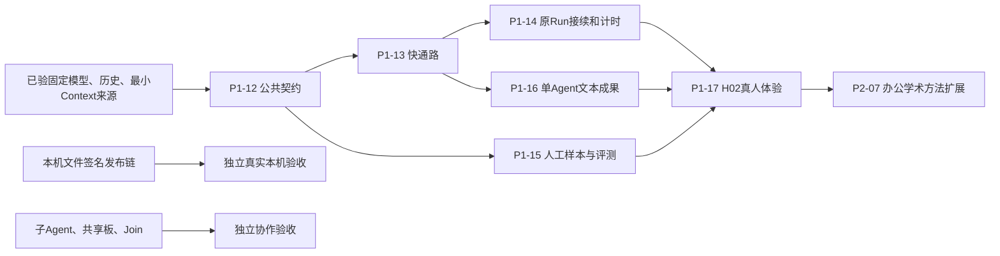

# H02：下一次对话与单 Agent 文本体验开发安排

2026-10-14。方向已确认，**工作包待开发；尚未发布新的 worker 开工标签/SHA**。本页由 [ADR-001](../decisions/ADR-001-conversation-and-delivery.md) 约束，任务权威在 planning/catalog.py，生成轮次页记录精确依赖。

## 1. 按模块—阶段—每轮任务推进

| 工作包 | 主责/模块 | 每轮目标和任务 | 目录与退出条件 |
| --- | --- | --- | --- |
| [P1-12](rounds/P1-12.md) | A：公共协议、Run/API | 固定首次动作、消息完成、原问题答复/纠正、暂停计时对象；发布兼容契约与消费例 | contracts/、src/uaw/shared/、docs/api/；准确来源、迁移/旧数据方案可审阅 |
| [P1-13](rounds/P1-13.md) | A：Agent/Intent/Run接线 | 普通首次调用直接回答/用工具/提问；消息与正式成果分流；不固定独立理解/自评 | src/uaw/agent/、intent/、run/、resources/prompts/；真实普通样本一次成功调用，全部失败/费用另计 |
| [P1-14](rounds/P1-14.md) | A：Run控制；B：页面 | 原 Run 追加回答、纠正、安全边界、暂停与恢复、刷新/幂等 | src/uaw/run/、api/、apps/web/src/；实际同Run连续问答、长等待/取消/授权失效/重启通过 |
| [P1-15](rounds/P1-15.md) | A：独立评测 | 人工核对小样本/反例，旧新策略实测；分别报告答案错误/漏判/不必要阻断 | tests/fixtures/evaluation/、ops/、docs/implementation/evaluation/；关键概念/证据错误阻断，指标分母和失败清晰 |
| [P1-16](rounds/P1-16.md) | A：文本成果；B：审阅 | 粘贴材料→来源Context→固定模型→Artifact/准确引用→逐项检查/接受；单Agent独立验收 | src/uaw/workspace/、agent/completion/、apps/web/src/；办公与学术各一个完整真实交付 |
| [P1-17](rounds/P1-17.md) | A集成、用户本人 | 固定新版本、实际启动，体验对话→澄清→纠正→文本成果，按原owner修复和复体验 | docs/implementation/human-tests/；工程、事实质量、本人体验、产品接受分别记录 |

这些是目标目录；worker 具体允许文件在正式分包时固定，不授权 A 代写 B/C/D 的业务源码。

## 2. 可并行的安排

A 先提交公共协议，再让 B 消费实际来源做问题答复/纠正与审阅页面。P1-15 样本和 harness 可与快通路开发并行，最终实测用准确候选源码。

C/D 继续本机链的原接口和证据缺口，具体下一包在来源准备好后派发；它们不是 H02 文本门槛。无需给空闲会话虚构任务。后续单 Agent 的 P2-07 不依赖 P2-06 Join，也不自动补入 P1-11 完整本机写入测试门槛；协作和代码完整目标保留。

## 3. H02 必过体验

1. 普通解释/比较/发散能得到有用回答，小歧义给假设或少量解释；缺必需原文仍具体提问。
2. 用户回答问题后原 run_id 接续，历史/输入/未受影响成果保留；无需先停止重新发送。
3. 等待用户超过原主动执行时限仍按剩余额度续跑；取消、费用上限及授权期限分别正确处理。
4. 用户补充纠正明确显示受理/生效状态；页面刷新不重复任务，终态后新请求有独立 Run。
5. 粘贴办公/学术材料产生可读文本或 Markdown 成果、准确引用、逐项核验与合同要求的本人接受。
6. 固定人工样本通过关键事实和证据门槛，记录不必要提问、模型调用/等待/用量/全部失败与 pending费用。

先准备真正可体验版本，再提供实际入口，本人体验与成果接受由用户操作。原 H01 历史和取消状态不改变。本轮不要求用户重新配对/选目录才能测试粘贴文本。

## 4. 发布与分派

当前仅文档/计划修订，不发布“已可开工”的运行基线。A 完成 P1-12 和最小来源示例后，另提交正式 DISPATCH、准确标签/SHA、允许路径和会话提示词。逐包审阅接线，模块回归与跨模块回归按受影响风险执行，汇合里程碑再做一次相应全量。

性能记录以普通无工具调用数、主动执行、用户总等待和接受成果全成本比较 A32；一条 108.5 秒记录只是参考样本。新非关键阈值跑前填写，不凭一条样例宣称普遍加速或质量达标。
